<p align="center">
  
</p>

<h1 align="center">BioManager</h1>

<p align="center">
  <b>Your lab's animals, stocks and supplies — in one place, instead of twenty spreadsheets.</b><br>
  Mice · zebrafish · flies · worms · plasmids · samples · orders · reagents · chemicals · antibodies · viruses · calendar · notebook
</p>

<p align="center">
  
  
  
  
  
  <a href="LICENSE"></a>
</p>

<p align="center">
  <a href="#-what-you-can-track">What it tracks</a> ·
  <a href="#-features-across-the-app">Features</a> ·
  <a href="#-ways-to-run-it">Ways to run it</a> ·
  <a href="#-getting-started">Get started</a> ·
  <a href="#-a-first-week-with-biomanager">First week</a> ·
  <a href="#-documentation">Docs</a>
</p>

<p align="center">
  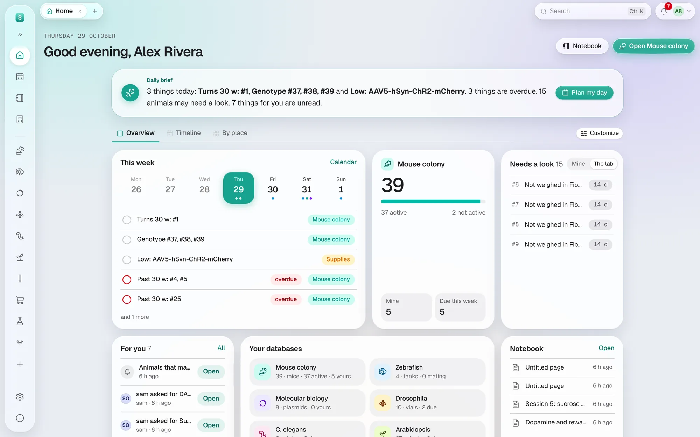
  <br><sub><i>Home — every morning, what needs doing today.</i></sub>
</p>

---

BioManager replaces the pile of spreadsheets, whiteboards and paper cage
cards most labs run on. You edit records **the way you would in a
spreadsheet**, but underneath is a real database. It knows which mouse is
in which cage, when a litter needs weaning, which fly vials need flipping
and which antibody is about to expire — and it tells you.

It runs as a **desktop app** for one person, or on a **lab server** that
everyone signs in to from a browser, including on their phone at the rack.

<table>
  <tr>
    <td width="33%" valign="top">
      <h3>🧑‍🔬 Lab members</h3>
      Manage your own lines, fish, stocks and samples without hunting
      through someone else's spreadsheet.
    </td>
    <td width="33%" valign="top">
      <h3>📋 Lab managers &amp; PIs</h3>
      A census that is actually complete: who owns what, which cages are
      idle, what is overdue.
    </td>
    <td width="33%" valign="top">
      <h3>🧬 Multi-organism labs</h3>
      Mice, fish, flies, worms and plants side by side — plus a database
      for any other organism, set up in a few clicks.
    </td>
  </tr>
</table>

---

## 🔬 What you can track

| | Module | In one line |
|:-:|---|---|
| 🐭 | [**Mouse colony**](#-mouse-colony) | Mice, cages, litters, breeders, strains, experiments and racks |
| 🐟 | [**Zebrafish**](#-zebrafish) | Lines, tanks, fish, clutches, matings and water systems |
| 🪰 | [**Drosophila & C. elegans**](#-drosophila-and-c-elegans) | Vials and plates, crosses, and temperature-aware flip schedules |
| 🌱 | [**Plants and field crops**](#-plants-and-field-crops) | Sowings, trays or plots, harvests kept as seed lots and sown again, generations and the 3:1 |
| 🦎 | [**Any other organism**](#-any-other-organism) | Your own database, in your own words, with no programming |
| 🧬 | [**Plasmids**](#-plasmids) | Sequences with an interactive map, assembly of new ones, and where each tube lives; primers, glycerol stocks and viruses beside them |
| 🧪 | [**Lab inventories**](#-lab-inventories) | Samples, orders, reagents, chemicals, antibodies, viruses, primers, glycerol stocks, cell lines, or a list of your own |
| 📅 | [**Calendar & notebook**](#-calendar-and-notebook) | Experiments, to-dos and colony dates; a shared lab notebook with data sheets, protocols, paper notes and meeting notes |

### 🐭 Mouse colony

The most complete module, built around how a mouse room actually works.
Tabs across the top: **Mice**, **Cages**, **Litters**, **Breeders**,
**Experiments**, **Strains** and **Dropdowns**. **My colony**, **My
groups**, **Shared** and **Everyone** change which mice and cages you see,
never what you may edit.

<p align="center">
  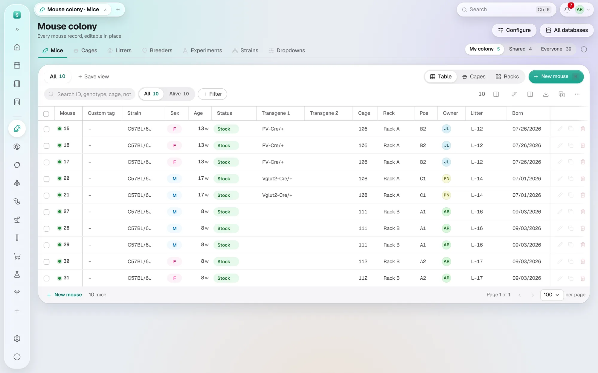
</p>

- **Mice** — a spreadsheet of every animal: ID, custom tag, strain, sex, age, status,
  transgenes, cage, rack, owner and notes. IDs are assigned in order and
  never reused; the **Custom tag** beside the ID is however the animal itself
  is marked — an ear tag number, an ear punch such as RF or LB, a tail tattoo
  — so you can find the mouse in your hand, and search finds it by that too.
  A lab that doesn't mark its mice unticks it under **Columns**. **Strain**,
  after it, is the mouse's background — C57BL/6J, BALB/cJ, 129S1/SvImJ… —
  picked from the colony's strain choices (the **Dropdowns** tab, which starts
  with the common ones) or typed. A mouse is alive until it has a date of death. The dot
  before its ID shows its age at a glance: blue under 8 weeks, green from
  8 to 30 weeks, red past 30 weeks, and grey once it is not alive.
- **Cages** — every cage with its **Card ID** (the number on the animal
  facility's own cage card, if it has one), rack position, purpose, the
  mice inside (with the sex breakdown), litter born and the P21 weaning
  date side by side, then its genotype and owner. Type over a cage's
  number to renumber it; its mice go with it. A cage's mice show the
  transgene columns the Mice tab shows. A cage's purpose is **Breeding**
  (a mating cage, the only one with Litter born, Genotyping and Wean),
  **Breeder** (the lab's breeding stock, shared with the lab; each person
  keeps part of it) or **Experiment**, and an admin can add the lab's own
  under **Configure → Cage purposes**. Above the cages, **All**,
  **Active** (cages with living mice) and a button per purpose show just
  those cages; a purpose's button lists only its cages with living mice,
  and **All** still shows the past ones.
  Each cage shows its mice beneath it, to edit right there and wean
  (**Close all** folds them to one row each), or switch to **Cards**: a
  card per cage with its mice and its actions, as on a rack.
  A position in a rack can hold more than one cage (a new cage is often
  set up there before the old one is ended): the **Rack grid** shows the
  one put there last and marks the position **!** while two or more there
  have living mice; hover over or tap the **!** to list and open them all.
  Its **Unplaced** list holds the cages with living mice that have no
  position yet; empty cages stay out of it (the table still lists them).
  Changing a rack's rows, columns or position names asks first what
  happens to the cages in it, listing each: **Keep each position name**
  (F7 stays F7, in the cell called that now) or **Keep each in the same
  cell** (its name changes); one the new layout has no place for stays in
  the rack, unplaced. Fish racks, fly and worm racks and boxes ask the same.
- **Litters** — on a Breeding (mating) cage, **Litter born** records the birth
  (or type the date in the cage's **Litter born** cell, which only a Breeding
  cage takes) once, and the weaning date (P21) and genotyping date (P28), or the days
  the lab sets in **Settings → General**, follow from it, on Home and the
  calendar. **Genotyping** takes the parents' mouse numbers and how many
  pups were born, and makes the litter (numbered L-1, L-2, L-3…) and a
  mouse for each pup, waiting in the genotyping queue on Home. **Wean**
  starts filled with the cage's pups, females and males apart, and sends
  each row to a new or existing cage; weaning before P18 asks first, and
  a weaned litter leaves every list. Birth dates in the future are
  refused. A cage can have two litters at once (a trio's second female
  gives birth before the first litter is weaned): **Litter born** then
  asks whether it is **Another litter**, kept beside the first with its
  own weaning and genotyping dates, or **Correct the date** of the first.
  The cage lists each litter with its age, Home and the calendar show
  each one ("Wean Cage 101 (born Sep 29)"), and **Genotyping** and
  **Wean** ask which litter, the oldest first.
- **Breeders** — the Breeder cages, the lab's breeding stock, at a glance,
  with the breeders counted by genotype and those past 30 weeks flagged;
  **Pick** takes a breeder as yours to set up a mating, and its owner is
  told. A Breeder cage left empty for over 90 days, and a mouse in one
  that ended that long ago, wait behind **Show them**.
- **Strains** and **Experiments** — your lab's lines with owners, and
  groups of mice under one experiment with a shared treatment group.
  An experiment's page has its details on top; then a **sheet of its
  mice** that switches between **Treatment** (each manipulation day as a
  column: who got it, and how much) and **Body weight** (a column a day,
  typed in place); then the body weight over the days as a chart, the
  manipulation days dashed, each saying what was done when you point at
  it. **Record manipulation** records what you just did (Tamoxifen
  20 mg/kg i.p. to the HDM group, today), or a day of the **Regimen**
  (HDM 25 µg intranasal on days 2–5), with each mouse's dose worked out
  from its latest weight, and the volume given the solution's
  concentration. Day 1 is the start date. A **Stimulation** (optogenetic,
  electrical, TMS…) keeps its frequency, intensity, pulse width and
  duration. The readout can be body weight, tumour volume, a clinical
  score, survival or your own, chosen in **New experiment** or later.
  - **Readouts worked out from what you measure.** Under **Readout**,
    *Worked out by BioManager from what you measure* has tumour volume
    from caliper length and width (L × W² / 2) or three diameters
    (π/6 × L × W × H), whichever your lab uses; ΔCt, ΔΔCt and fold change
    (2^−ΔΔCt) against the **Control group**'s mean ΔCt that day; % of a
    baseline; and absorbance less the blank. You type the length and width
    (or each gene's Ct, or the OD and blank) on the page or in bench mode;
    BioManager works out the value, keeps what you measured with it
    (shown when you point at the value, and in the export), and refuses a
    missing, negative or impossible number in words.
  - **Plates from a plate reader or qPCR machine.** **Plate layout**, above
    the sheet, lays out a 24-, 48-, 96- or 384-well plate: pick an animal,
    **Blank** or **Standard** (with its concentration) and click or drag
    across wells, or **Fill in order** with two or three wells each (an
    animal's replicates). The layout is kept with the experiment, and the
    next plate opens on it (*Same as last plate*). **Read a plate →** takes
    the instrument's export, pasted or as a CSV, TSV or Excel file: a grid
    with row letters and column numbers, or a list of wells and values
    (Well, Target, Ct for a qPCR run with several genes). Each well's value
    shows on the plate, replicates far from the others and wells past what
    the instrument reads are flagged, and a click leaves a well out. Each
    animal's wells are averaged, the blank taken off or the value read off
    the standard curve, or for ΔCt, ΔΔCt and fold change the target and
    reference genes' Cts used; **Save readings** writes them as the day's
    readout, and the plate and its file are kept as where they came from.
    The standard curve is a 4PL (four-parameter logistic, the usual for
    an ELISA) when there are five or more standards over a tenfold
    dilution, a straight line otherwise, or whichever you choose under
    **Curve** (Linear, Log–log, 4PL); it is drawn beside the plate with
    its r², and a value past the standards is marked. **Readout** in the
    plate says what the plate fills: the experiment's main readout, or
    **Another measure…** of the same animals kept beside it, such as an
    IL-6 ELISA in a tumour experiment, or a gene's ΔCt (ΔΔCt, fold
    change) from a qPCR run, typed on the sheet as the two Cts or the ΔCt.
    Each measure gets its own button on the sheet, its own chart and its
    own sheet in **Export**; its **•••** renames it, keeping its
    readings, makes it another kind (its readings worked out again, where
    they can be), or deletes it with them (Batch history can undo each). The
    main readout stays the one the plan and the tests are about. A saved
    plate is one step in **Batch history**, so **Undo** takes all of it
    back.
  - **The regimen reminds you; you record it.** Days still to do are on
    the calendar, and the experiment's owner gets a notification each
    morning of what is due (Settings → Notifications → Experiments).
    Nothing is marked done until someone records it. **Save as a
    regimen…** keeps a regimen to start the next cohort from.
  - **Animals that may need a look**, on Home: a mouse of an experiment
    down the lab's weight-loss threshold from its first weight in it (or
    from its peak of the last 30 days), an animal of any organism not weighed for longer than
    the regimen's weighing days allow (7 days if it plans none; animals
    left out of the analysis aren't counted), and a mouse whose status
    says *experiment* while it is in no experiment, or something else
    (geno, breeder) while it is in an active one.
  - **What was used**: every day recorded keeps the reagent and its lot,
    however it is recorded (the page, bench mode, an AI assistant): the
    bottle the regimen names, or the one in your inventories named as what
    is given, unless you pick another bottle or type another lot. A lot
    already expired that day is recorded with a warning. Tick **Take what
    they got off the inventory** to take the amounts given off the
    bottle's quantity. When a day is a sampling, you can choose to **make
    a sample record for each mouse** in Samples, its source that mouse.
  - **Tests by day**: stars on the chart where the groups differ (Welch's
    t-test for two groups, one-way ANOVA for more, χ² for survival
    counts), with each test in a table below it.
  - **Export** gives an Excel workbook: the readout (long, for Prism or R,
    and wide), each animal's manipulations with the reagent and lot, and
    the tests.
  - **Planned, then started.** An experiment an AI assistant designs with
    you arrives as **Planned**: nothing is due until you press **Start**,
    which keeps a copy of the plan (the groups, the **Main readout day**,
    the **Planned test**). After that, changing the main readout, the
    groups, the test, or leaving an animal out (**Leave out…**) asks for a
    one-line reason; **Changes from the plan** lists each, beside
    **Planned → done**, and the export gets a sheet of them.
  - **Bench mode**, on a phone (scan its QR code): one animal at a time,
    with big numbers: weigh or count each (or type what you measured, a
    tumour's length and width, and see the volume), record another
    measure of the experiment the same way, or give each today's
    manipulation and tick it. **Scan a card** reads a cage, tank or vial
    card with the phone's camera and jumps to the animal in it.

<table>
  <tr>
    <td width="50%">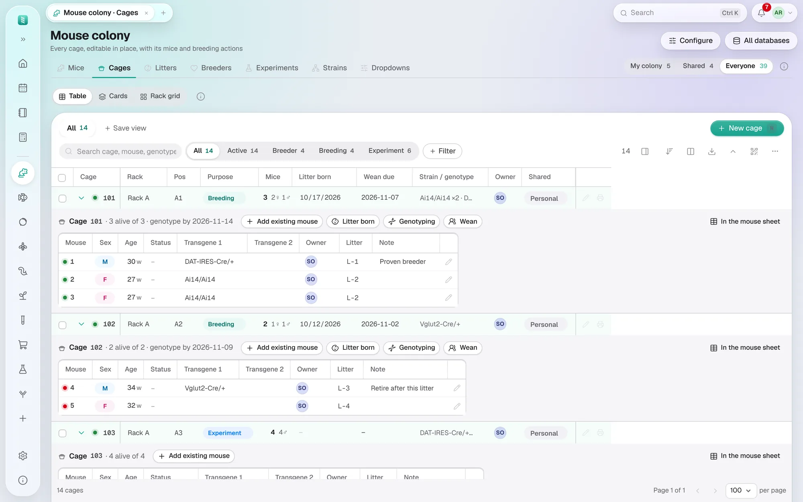</td>
    <td width="50%">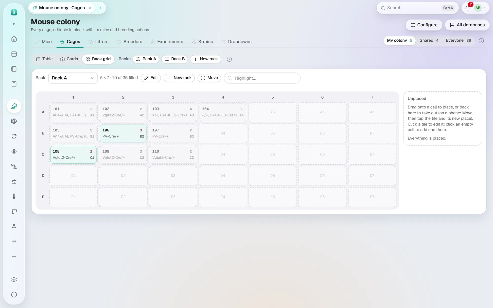</td>
  </tr>
  <tr>
    <td align="center"><sub><b>Cages</b> — one row per cage, mice one click away</sub></td>
    <td align="center"><sub><b>Rack grid</b> — drag a cage to move it</sub></td>
  </tr>
</table>

### 🐟 Zebrafish

Lines with their ZFIN names and founders, tanks, individual fish,
clutches, water systems and a sac log. **Set up a mating** records which
tanks went in and when they go back, and they stay on Home until someone
marks them **Returned**; **New clutch** records each fertilisation against
its cross. **Log reading** keeps each system's temperature, pH,
conductivity and salinity, with a chart, and can raise an alarm. A tank
can hold a group with a headcount, or resolve into named individuals.
A fish row's dot is blue under 3 months post fertilisation, green to 18
months and red after. The **Experiments** tab, beside Tanks and Fish, works as the mouse
colony's does, with fish in mind: start with a tank's fish rows, or a clutch's
larvae, record drug in the water, microinjection, a heat shock or an
injury, and follow survival (how many of those at the start are still
alive), standard length or a phenotype.

### 🪰 Drosophila and C. elegans

Vial (fly) and plate (worm) databases: vials in racks and plates in
boxes, inside incubators, each incubator at its own temperature.

- Label each vial with its genotype and purpose: stock, experiment,
  cross or progeny.
- Set up crosses, **Collect eggs** into a new vial (worms: **Pick
  progeny** onto a new plate), and see when the progeny will be adults.
- **Flip / chunk schedules that follow temperature** — flip every 14 days
  at 25 °C, every 28 at 18 °C, set in the database's **Settings →
  Temperatures and timing** — and a rack moved to another incubator
  changes its schedule by itself. **Schedule** shows what is overdue, due
  today and coming up, and each fly or worm database has its own card on
  Home.
- **Each rack's grid says when it was last flipped** and when the next is
  due (red when overdue), with a **Flipped today** button beside Edit.
- A vial's or plate's dot is blue while its progeny are still developing,
  green once they are adults, and red once it is older than its rack's
  flip or chunk interval.
- Worms: **New frozen lot** records a freeze, to thaw onto a plate when a
  line is lost.
- An **Experiments** tab for vials or plates (a rack's at once), with
  the manipulations flies and worms get: drug in the food or on the plate,
  RNAi feeding, a temperature shift, starvation, infection, flipping to
  fresh food. They have no body weight, so the readout is **survival**
  (how many of those at the start are alive), or eclosion and climbing for
  flies, brood size and paralysis for worms.

<table>
  <tr>
    <td width="50%">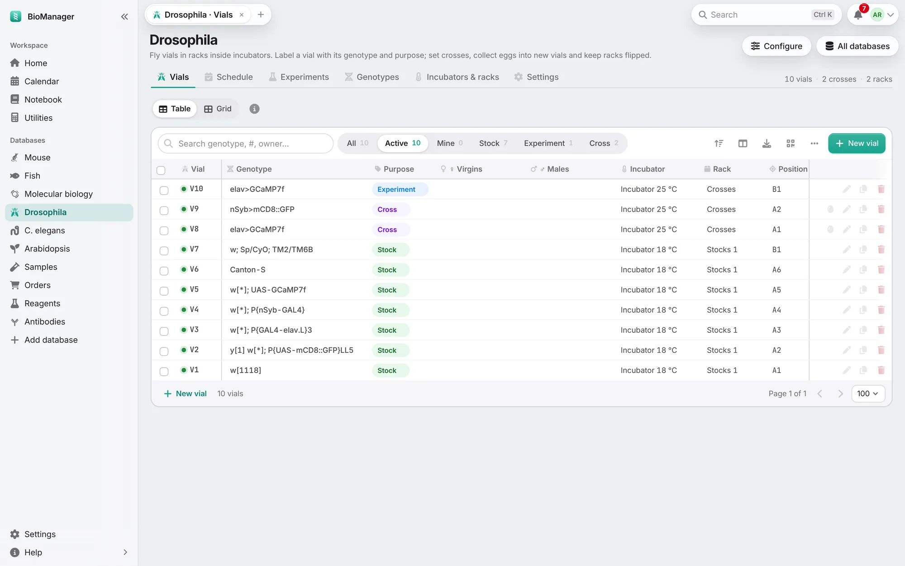</td>
    <td width="50%">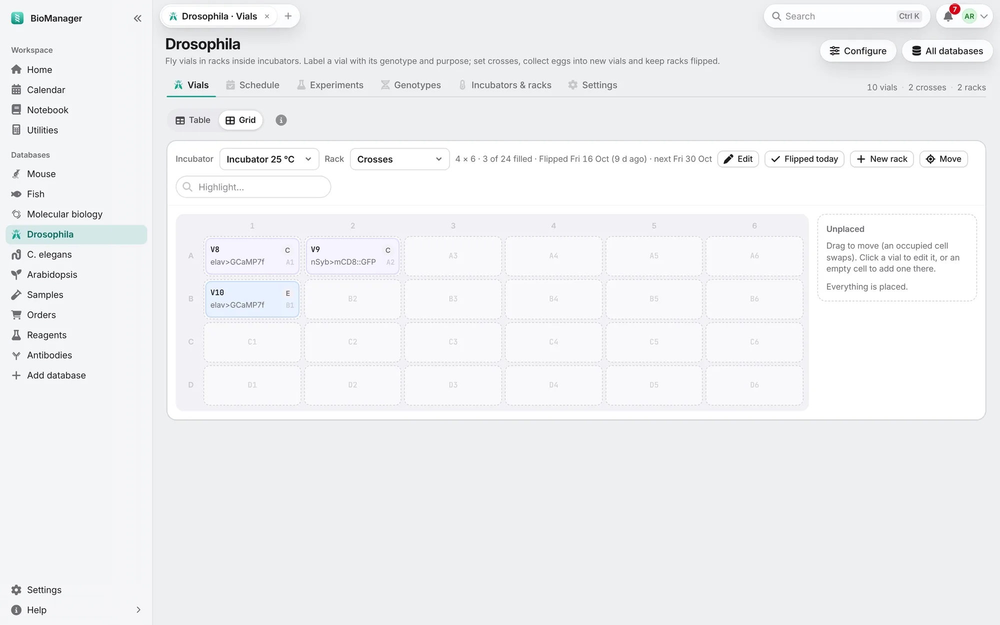</td>
  </tr>
  <tr>
    <td align="center"><sub><b>Vials</b> — genotype, purpose, incubator, rack</sub></td>
    <td align="center"><sub><b>Grid</b> — the rack as it sits in the incubator</sub></td>
  </tr>
</table>

### 🌱 Plants and field crops

**Add database → Plants** (pots and trays in growth rooms or a greenhouse)
or **Field crops** (plots in a field, raised first in a nursery and
transplanted) makes a database that speaks of plants: it is **Sown** and
**Harvested**, not born and dead, and has no sex.

- **Sowings** — each with its date, the seed lot it came from, its
  generation (T2, F3) and its stage (seedling, transplanted, flowering…,
  or the nursery for a field crop). The **Schedule** counts days after
  sowing: out of the cold, count germination, transplant, harvest.
- **Seeds** — every seed lot: its line and generation, where it was
  harvested from, how much is left (mg, g, seeds or tubes), where it is
  kept, its germination, and its **descent** back through each sowing and
  harvest to the first lot. The wheat button on a plant, a sowing or a
  cross **harvests** its seed into a new lot a generation on (seed from a
  cross is F1) and can mark the plants harvested; **Sow** on a lot starts a
  sowing from it and takes the seed off what is left. **Labels** prints
  them for tubes or packets.
- **The selection plate** — type a T2 lot's resistant and sensitive
  seedlings and the sheet says whether they fit 3:1 (one insertion),
  15:1 (two), or all resistant (homozygous), by χ².
- **Lines** keep their background, source and stock number, selection
  marker, whether they are transgenic and under which biosafety permit,
  and the **construct**: a plasmid from the Plasmids database, linked.
- **Places** are growth rooms, growth chambers, greenhouses, nurseries or
  fields; a field is a grid of plots, as a rack is of cages. Readings log
  temperature, humidity, light and day length.
- A plant's dot is blue while it is a seedling (under 14 days), green, then
  red past 70; every number and word here can be changed in **Configure**.

<p align="center">
  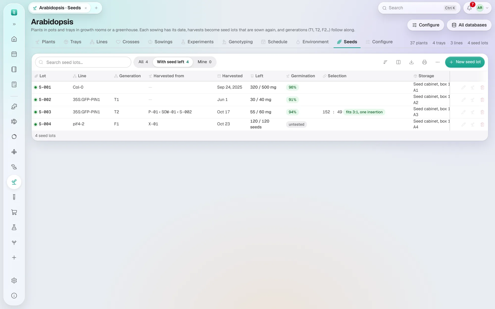
</p>

### 🦎 Any other organism

Choose **Add database** in the sidebar, start from a mouse-like,
zebrafish-like, plant-like or blank organism, and describe it:

- **The words it uses** — cage, tank, vial or plate; strain, line or
  stock; litter, clutch or progeny. The interface then speaks your
  language. Age can be counted in days, weeks, days post-fertilisation,
  generations or passages.
- **How it is counted** — individual animals, groups with a headcount,
  or both.
- **What it needs**, from a checklist — crosses, cohorts, a nursery
  stage, genotyping, environment logs, cryo inventory, seed lots, census
  and more.
- **Its own words** for its dates (Hatched, Sown), its stages and the
  kinds of place it keeps them in, under **Configure**; leave **Sexes**
  empty and the Sex column goes. **Young until** and **Old after** colour
  the dot before an ID by age.
- **Schedules** like "wean at P21", which can vary with rearing
  temperature. Each rule counts from its own last **Done** (feeding
  doesn't restart the split's clock), and Done can be dated to the day it
  was really done.
- **Your own columns** — text, numbers, dates, dropdowns, people, links
  or a plasmid, edited in the sheet like the others and set on many rows
  at once.
- An **Experiments** tab, the same as the mouse colony's, on your
  animals, groups or cohorts (a housing's at once), with body weight,
  length, survival or your own readout.
- **Who it is for** — just you (a personal database only you and admins
  see), or the whole lab.

<p align="center">
  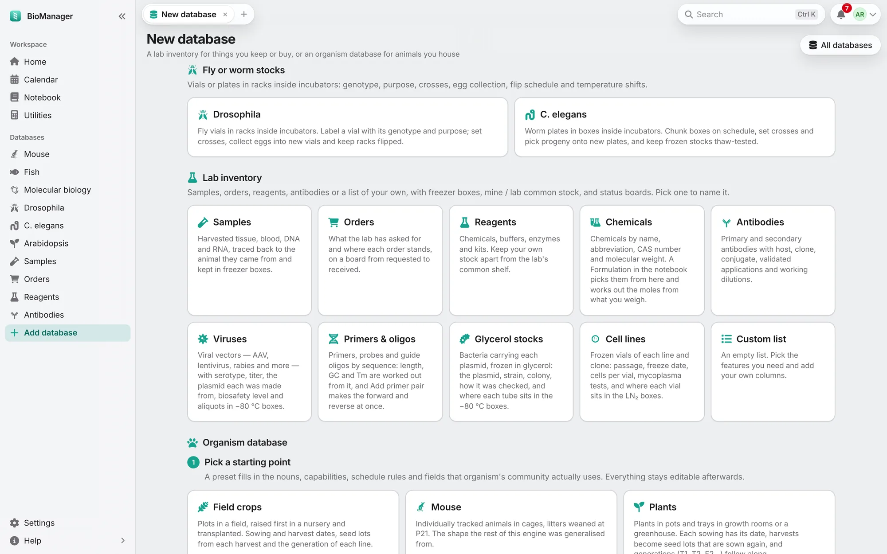
</p>

> [!TIP]
> Xenopus, axolotls, cell lines, yeast strains — anything you keep in
> containers and breed or passage fits here. No code and no migration.

**Only what your lab keeps, in the order you work.** No database is there
by default, the mouse colony, zebrafish and plasmids included: the lab
adds what it uses (from the setup survey, or **Add database → Ready-made
databases**), and an admin can switch one off in **Settings → Databases**
without deleting anything; its records come back when it is switched on.
An admin drags the databases into the lab's order right in the sidebar
(or **All databases → Order in the sidebar**), the same for everyone.
**All databases** groups
them into Animals and Molecular & supplies, and every database has the same
two buttons beside its name: **Configure** (for whoever may change it) and
**All databases**. Icons are picked from a grid of the icons themselves.

### 🧬 Plasmids

Upload a GenBank, FASTA or SnapGene file and BioManager keeps the sequence
and its features, with an interactive map you can edit. Plasmid boxes sit
on the same rack grid as everything else, so every tube has an address.
Each tube keeps its miniprep's concentration (ng/µL) and 260/280, and a
plasmid can be **Lab common**: anyone can edit it (or, shared with a
project group, its members), while its owner still decides whose it is. A plasmid's page lists the notebook pages that
`@plasmid` it, and its address is its number (plasmid #12 is `/plasmid/12`).
Show them as a **Table**, by storage **Boxes**, or as a **List**. In the
sheet, **Sequence** beside a plasmid's number opens its sequence and map
(**Add sequence** when it has none yet). **Download** gives it as
GenBank or FASTA, and **Versions** keeps every earlier sequence to
restore. **Made from** records its backbone, insert or template (in the
lab or from Addgene) and how it was made; its page shows what it was made
from and what was made from it, with a family tree. **Assemble a
plasmid** builds the next one from the ones you have: fill a tray with
fragments — a whole plasmid, one feature, a region, or a piece an enzyme
leaves — and put them together by **digest and ligation**, by **Gibson /
NEBuilder HiFi**, or by **Golden Gate**. Every junction shows its own
bases, and one line says what is wrong and which end it is ("Fragment 2's
3′ end has no overlap with fragment 3") before you make anything. The
product arrives as an ordinary plasmid, with every fragment's features at
their new places, each fragment marked on its map, **Made from** filled in
for all of them, and — for a Gibson — the primers it needs designed,
costed by melting temperature and waiting in the Primers database to
order. Primers, glycerol stocks and viruses each name the plasmid they came
from, so they are tabs of one area rather than four entries in the
sidebar: **Molecular biology**, called just **Plasmids** while the lab
has none of them. The **Feature library**
keeps the lab's elements (promoters, ITRs, LTRs, WPRE, resistance genes)
by sequence, from any well-annotated map, and **Detect features** marks
them on another plasmid; a lab that installs [pLannotate](https://github.com/mmcguffi/pLannotate) on its server also gets
**Annotate with pLannotate**, which finds elements by alignment rather than
exact matching. Nothing is built into the library: its elements come from
your own files (**Add to library** above a map, or **Read elements from
files**), and an admin can **Add the common-features pack**, about 1,900
elements from widely used plasmids, downloaded when asked for. **Files** on its Storage tab keeps
the sequencing reads, gel photos and datasheets that belong with it, and
they come along in Export my data. **Verify sequencing**, below the map,
checks Sanger reads of a miniprep or clone against it: choose the `.ab1`
chromatograms (or FASTA, or paste the bases) and each read is trimmed of
its poor ends, placed on the map on either strand (across the origin
too), and compared base by base. You get a line for the clone ("Matches
the map across 425–1,359, covering EGFP", or "1 difference from the map:
C→A at 740 in EGFP (A14D)"), where the reads lie over the map, and every
mismatch, insertion and deletion with the read's quality there, the
features it falls in and what it does to a coding sequence's amino acid;
one at low quality is marked as a likely sequencing error. From an
`.ab1`, each difference shows its stretch of trace, and a read with
second peaks under many bases is said to look like a mix of two clones
(and where they part, when an insertion or deletion splits them). **Keep the
reads and the result with this plasmid's files** files them under
**Files**, each noted with what it showed, to check again later. An
assistant can do the same with `verify_sequencing`, from reads uploaded
as captures. A primer drawn on the
map is kept in the Primers database, linked to the plasmid; the page lists
where each binds, and **Copy for ordering** or **Export for ordering**
gives the ticked ones to your oligo supplier. Before ordering another,
**Find saved primers** looks through every primer the lab has saved,
whichever plasmid it was made for, and lists the ones that bind this
sequence — exact matches, and those matching at the 3′ end with a 5′
tail — and **Show on map** draws them on the map to look at, without
saving them into it.

<p align="center">
  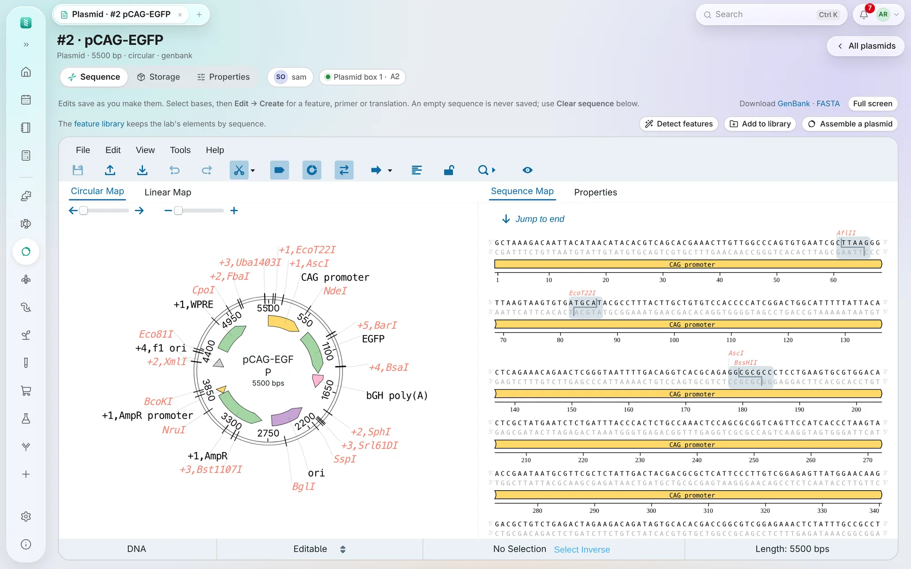
</p>

Every database takes **columns of your own** — *Configure → Your own
columns*, on the mouse colony, zebrafish and plasmids as on the others: a
weight, a score, a date, a choice from your own list. They show in the
sheet and in each record, and come along in Export my data. Taking a column
away hides it without losing what your records hold in it.

### 🧪 Lab inventories

Every inventory runs on the same engine, starting from a preset you can
change:

| Preset | Tracks |
| --- | --- |
| 🧫 **Samples** | harvested tissue and material, linked to the animal it came from (type its ID in **Source**, or set a whole harvest at once), with that mouse's **Custom tag** beside it and its **Genotype** from the colony, and its sex, age, genotype, status, owner and cage on hovering the arrow that opens it; a tab for each type (tissue, blood, DNA, RNA… and any you add with **+**), each with its own columns: a tissue's **Tissue**, **Fixation** and **Orientation**, a DNA's or RNA's concentration, unit, 260/280, 260/230 and volume as numbers; stored at RT / 4 °C / −20 °C / −80 °C / LN₂ in a box position |
| 🛒 **Orders** | a board from *requested* to *ordered* to *received*, with vendor, catalogue number, price and grant account |
| ⚗️ **Reagents** | quantity (with a **Low at** level that marks a bottle low as it runs down), concentration, CAS number, hazards (several per bottle), supplier and lot, and expiry dates with warnings |
| 🧂 **Chemicals** | your lab's chemical list: name, abbreviation, CAS number, molecular weight, purity and density, with lot, expiry and where each bottle is, and its hazards, several at once, including the controlled classes a safety office asks about (drug and explosive precursors, highly toxic); a **Formulation** in the notebook picks from it and works out the moles, and Utilities' calculators know each molecular weight |
| 🔬 **Antibodies** | host, clonality, clone, conjugate, reactivity, applications, dilution, RRID and where each vial is stored |
| 🦠 **Viruses** | AAV, lentivirus, rabies and other vectors: serotype, promoter, payload, titer, biosafety level, the date made, and the plasmid each was made from — which opens that plasmid, or its sequence and map to read, and whose page lists every virus made from it |
| 🧬 **Primers & oligos** | sequence, direction, target and pair, with length, GC % and Tm worked out from the sequence; **Add primer pair** makes the forward and reverse at once, linked and side by side in a box; a primer drawn on a plasmid's map lands here with the plasmid named, **Find saved primers** on a plasmid lists the ones here that already bind it, and **Copy for ordering** / **Export for ordering** hand the ticked ones to your supplier |
| 🧪 **Glycerol stocks** | bacteria carrying each plasmid: the plasmid, strain, colony, resistance, how it was checked and the date frozen, and its place in a −80 °C box; the plasmid's page lists its stocks and where each is |
| 🧫 **Cell lines** | frozen vials of each line and clone: species, parent, passage, freeze date, cells per vial, mycoplasma result and date, and where each vial sits in the LN₂ boxes |
| 📝 **Custom** | whatever you define |

Each inventory can keep **your own stock** apart from **lab common
stock**, and statuses and categories can be renamed without losing items.
Renaming a database moves it to its new name's address; the old one keeps
working, so printed labels, bookmarks and `@mentions` still find it. Every
database has a name of its own (one another database has is refused), so
`@` and a name in a notebook page always means one database.

- **A tab for each type** — Samples opens on **All**, with a tab beside it
  for each type: **Tissue** shows only tissue, with the columns a tissue
  has, and its boxes; **DNA** shows its concentrations and purities. A new
  sample made from a tab is of that type, and the dialog asks only for the
  columns used for the type chosen. **+** at the end adds a type; which
  columns each type uses is **Used for** in Configure, and any inventory can
  turn on **A tab for each type**.
- **Split notes** — a sheet brought in from somewhere else often left
  everything in the notes ("Tissue: Lung; Fixation: 4% PFA; control 2w").
  Tick the rows and **Split notes**: each "Column: value" goes into the
  column of that name, the rest stays in the notes, and Batch history can
  undo it.
- **Filter orders by status** — one tap shows only what is requested,
  ordered, received or cancelled.
- **Expired is red** — a reagent, chemical, antibody or virus past its expiry date
  has a red dot, number, name and date; **Expired** and **Expiring soon**
  show only those.
- **Low stock says so itself** — give a reagent, chemical, antibody, virus
  or primer a **Low at** level, in the unit of its quantity. When the
  quantity falls to it the status turns *low* (at 0, *empty*) and its owner
  is told; a reagent, chemical, antibody or virus is then listed on Home's
  **Expiring & low stock** with what is left. Topped up above it, it is
  *in stock* again. A quantity in words
  ("half a bottle") is left as it is, and so is a status set by hand.
- **Kept in ampoules, used in mL** — an item counted in ampoules, vials,
  tubes or bottles can have a **Pack size**, what one of them holds
  (`10 mL`), in the dialog and as a column you can show in the sheet.
  An AI assistant told "2 mL used" then takes 0.2 of an ampoule off its
  quantity; without one it says what is missing rather than guess.
- **Nothing half-filled** — an order can't be placed without its item,
  vendor, catalogue number and quantity. Configure chooses what any
  inventory requires.
- **Type it once** — every column suggests what the lab has typed before;
  pick an earlier item or catalogue number and the vendor, price and grant
  fill themselves in.
- **Order again** — one click on a reagent, chemical, antibody or virus starts a new order
  with its details, and the quantity, price and grant of the last time. A
  record that is already on order shows **On order**, and Order again says
  which order is open and who asked for it.
- **Requests reach the lab manager** — a new order tells the lab's admins,
  and whoever asked for it is told as it moves.
- **Boxes that look after themselves** — a tube marked used up, empty or
  discarded leaves its box position free (its location note keeps where it
  was); a box can say where it is kept (−80 °C, LN₂), and what goes in
  takes that as its *Stored at*; a tube put in a box with no position takes
  the next free one. **New box** can make several alike at once
  (*Tower A 1 … 13*).
- **Boxes inside fridges and cabinets** — a box, shelf or drawer can say
  what it is **Kept in**: *Fridge 2*, *Explosion-proof cabinet*. The sheet,
  labels and search then read *Fridge 2 › Box A · B3*, the **Box grid**
  picks the fridge or cabinet first, and typing a cabinet's name in the
  search lists what is in it, so the solvents in the explosion-proof
  cabinet are one search away. A place typed once is offered in every
  inventory.
- **From the box to the shelf** — when an order is marked received,
  BioManager asks **Add it to stock?**: a new reagent, chemical, antibody
  or virus with the name, vendor, catalogue number, lot, quantity and
  expiry already filled in (later, **To stock** on the order does the
  same). The order and the record then link to each other.

<table>
  <tr>
    <td width="50%">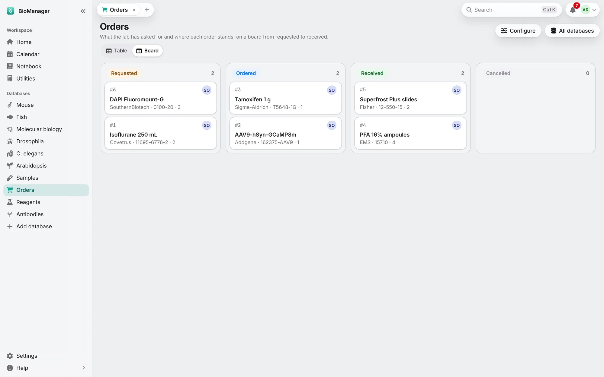</td>
    <td width="50%">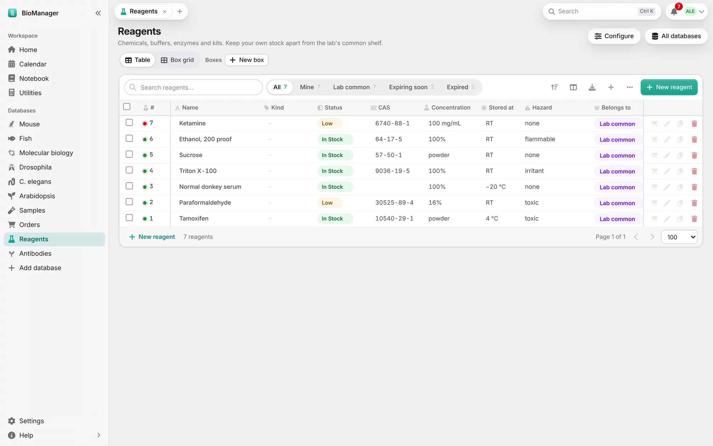</td>
  </tr>
  <tr>
    <td align="center"><sub><b>Orders</b> — drag a card when it arrives</sub></td>
    <td align="center"><sub><b>Reagents</b> — what's low, what's expiring</sub></td>
  </tr>
</table>

### 📅 Calendar and notebook

- **Calendar** — experiments and to-dos, with colony dates (weanings,
  genotyping, sac reminders), fly and worm flips, organism schedules and
  reagent expiry filled in for you. Shows your **Google Calendar** and any
  iCal subscription alongside, read-only, under **Connected calendars**.
  - **Who sees it**: an event or to-do is yours alone, the lab's or one
    of your project groups'. Your own is seen by nobody else, admins
    included. A shared event is everyone's to see, its owner's and the
    admins' to change; a shared to-do anyone it is for can tick off.
  - **Repeating events**: every so many days, weeks or months (every 2
    weeks, say), or every month on the same weekday ("the first Monday"), until a date. One date can be taken
    out (**Delete this one**) or changed on its own (**Change this one
    only**).
  - **Protocol timelines**: write the steps once in days from day 0
    (tamoxifen days 0–4, implant day 14, perfuse day 42), start them for an
    experiment or cohort, and every step lands on the calendar. Move day 0
    and they all move.
  - **Equipment booking**: time on the confocal or a rig; double bookings
    are refused, saying who has it. A booking can repeat every day, weekday
    or week until a date (if one repeat clashes, none is made), and
    **Duplicate** books the same instrument and times on another day.
    Instruments are added, renamed and removed under **Manage**.
  - **Time away**: leave and conferences, with what falls due while you
    are away and who covers it (they are told).
  - **On your phone**: a private link that Apple, Google or Outlook
    Calendar subscribes to, with just your things or the whole lab; it
    updates about every hour, and **Make a new link** stops the old one.
    Google fetches the link from the internet, so it needs a server open
    to the internet.
  - **Mac Calendar**, in the desktop app on a Mac, with no server needed:
    BioManager keeps a calendar called BioManager up to date in the Mac's
    own Calendar app, which takes it on to iCloud, Google or Outlook, and
    so to your phone. Choose just your things or the whole lab, and where
    it goes. For Google, first make a calendar called BioManager in Google
    Calendar on the web, because a Mac can't add one to a Google account.
    It updates while the app is open: every 15 minutes, and soon after a
    change. The calendar is BioManager's alone, and **Stop** takes it out
    again.
- **Lab notebook** — pages in topics, written like a document and saved as
  Markdown. Topics are folders, and a topic can hold topics of its own, as
  deep as you like: a page stays in the one it was made or moved to,
  whatever its kind. The notebook has one sidebar of its own (BioManager's
  folds to its icons there): at its top your notebook's name opens **Home**,
  **+** makes a **New page** in the topic you are in, and **Find a page…**
  narrows the list as you type (Enter searches inside every page); **Today**
  and the libraries stay at its foot. In the sidebar, **+** beside *Topics* names a new one,
  a topic's own **+** starts a page in it, and **•••** makes a **New topic
  inside**, changes its **Name and icon** (one of BioManager's icons, any
  emoji from your computer's emoji picker, or an SVG drawing of your own),
  moves it (**Move to…**) or
  deletes it (the topics inside it stay, one level up). Drag to tidy up: a
  page onto a topic moves it there, between two pages puts it there, and a
  topic onto another goes inside it (or above or below, near its edge).
  A topic's name opens its own page: the topics inside it as tiles, then
  its pages as cards or a list, by **Last edited**, **Name** or **Your
  order**. The star on a page or a card keeps it in **Favorites** at the
  top of the sidebar (once there is one), in your order. The notebook opens on **Home**: your
  favourites, what was edited lately and your topics. **Inbox** holds the
  pages in no topic yet; protocols, papers and talks, and a meeting series'
  notes are in **Protocols**, **Reading** and **Meetings** instead. The
  sidebar hides (its button, or Ctrl+\ / ⌘\) to give the page the window.
  **New page** asks for a title, the topic, the kind of page and what to
  start from (a built-in starter or one of your templates). A page's kind
  sits above its title, saying what it adds; click it to change the kind,
  which never moves the page. A long title wraps onto more lines, set well
  above the page's headings as in Notion, and **Add cover** puts a picture
  across the top. Above the page its place reads like a path (the topics
  its topic sits in, then its topic); click the topic to move it. A page links to mice, plasmids, orders and any inventory record
  (`@mouse 12`, `@antibodies 5`): type **@** and a name (written as it is,
  `anti-β-actin` or `Waf1/Cip1`), a catalogue number or lot, a database's
  name (`@antib` offers Antibodies and lists its records) or a colleague's
  name, for `@jordan`; the chip shows the
  record's name after its number, and its popover shows its lot and place. The record's
  dialog lists the pages that link it (**Used in notebook pages**), so the
  record and the notes point at each other. A colleague's `@name` is shown in
  their colour, and hovering it shows who they are: name, what they do,
  admin, member or guest, email, project groups and since when. Type **/** on a new line for
  everything below (Chinese words find things too, `/分栏`).
  - **Writing as in Notion**:
    - headings, lists, checklists, quotes and dividers;
    - **callouts** (note, tip, important, warning, caution);
    - **toggles** that open to show what they hide (each reader opens their own);
    - **2 or 3 columns** side by side, stacked on a phone;
    - **colour and highlight** for text (`==text==` highlights);
    - **pages in pages**: `/page` makes a new page inside this one and opens
      it; **Link to page** (or typing `[[`) links one that exists, and
      **Turn into page** makes a line a page. A link shows the page's title
      as it is now, the sidebar nests a page's pages under it, and **Linked
      from** on a page lists the pages that link it. Links to the app's own
      pages open in a BioManager tab;
    - a **table of contents**, a date, and a
      **reminder**, which puts a to-do in your calendar and links to it.

    It all stays readable Markdown: GitHub's `> [!WARNING]` alerts,
    `<details>`, and Pandoc's `::: column` and `[text]{.red}`.
  - **Experiments**: aim, setup, samples and lot numbers, steps, results
    and a summary.
    **Start experiment** (beside the status) and **Finished** stamp the
    times; running ones are listed at the top of the sidebar.
  - **Sign** a page when it should be the record of your work (your
    choice, page by page): you confirm who you are, its exact text is
    fingerprinted and kept, any live experiment in it is frozen, and it is
    locked (**Sign and lock**). A lab mate can **Witness** it; to change
    it, its owner gives a reason and **Open to amend**, and the reason stays
    in the record with every signature. A signed page can't be deleted.
  - **Colony experiment** (`/experiment`) shows an experiment on any of
    your animals in the page: its manipulations, the reagent and lot each
    day used (marked *(expired)* when the lot was past its expiry), when
    each was done and by whom, the amount each animal got, and its readout as a table and a
    chart (body weight in grams or % of the first, manipulation days
    marked), kept up to date. An experiment with other measures (an ELISA
    a plate filled) has a button for each beside the main readout; the one
    you pick is kept with the block. The block is in the app's language.
    **Freeze a copy** keeps what it shows at that moment in the page. On
    the experiment itself, **Add to notebook** makes your notebook page
    for it with that block already in.
  - **Reading notes** for papers: authors, journal, year, DOI, a link and a
    **Zotero** link as rows under the title. Paste a DOI, a link, or an
    item copied from Zotero (BibTeX, RIS or CSL JSON: set Zotero's Quick
    Copy to one of them) into **Fill in**, or into **Paper** in New page,
    and they are filled in, title too; a DOI alone is looked up at Crossref.
    **Open in Zotero** opens the item in Zotero. Give the note a **cover**
    (a figure from the paper, uploaded or picked from the page's own
    pictures). **Reading** in the notebook's sidebar lists every paper and
    talk you can open as cards with their covers, or as every picture in
    them, to find a paper by a figure you remember; search reads titles,
    authors, journals, DOIs, tags and picture captions.
  - **Paper notes straight from Zotero**: **Zotero** on the Reading page
    takes a read-only API key from zotero.org, then which library (yours
    or a lab group's), which collection (or all of it) and which topic.
    Each paper you add there becomes a paper note, with its authors,
    journal, year, DOI, abstract, tags and **Open in Zotero** link filled
    in, the next time you open the notebook (it looks at most every five
    minutes; **Check now** looks at once). A paper gets one note, ever,
    and the papers already there are left out unless you ask for them.
    Zotero has to sync to zotero.org, and BioManager has to reach it.
  - **Protocols** with numbered versions. **Start experiment**
    copies the steps as a checklist and records which version was followed.
    **Protocols** in the notebook's sidebar opens the lab's protocols as a
    page of their own: search them, open one to read or change it, make one
    with **New protocol**, and sort them into **folders** (**New folder**,
    then drag a protocol onto it, or pick its folder on the card or in the
    protocol's own bar). Each folder has an icon you pick when you make it;
    **Edit folder** changes its name or icon. Folders are the lab's, shared
    by everyone. Below
    them are a dozen common protocols built in (genotyping, perfusion,
    immunofluorescence, western, BCA, transformation, miniprep, TRIzol,
    qPCR, passaging, tamoxifen), to read and **Copy** into one of your own.
    In a page, `/protocol` opens the same protocols beside it, folder by
    folder, to insert one as a checklist.
    **Run the checklist step by step** (▶) goes through it at the bench one step at a time
    in large type: each tick gets the time, a deviation is written under the
    page's Deviations heading.
  - **Data sheets**: paste from Excel or import a CSV, add formula columns
    (`=B/mean(B)*100`), and get a bar, dot, box, scatter or line plot with
    SEM or SD error bars, a fitted line, and a t-test, Mann–Whitney or ANOVA
    (Holm-corrected pairs) with significance stars. Plots download as SVG or
    PNG. A log pasted with its headers (time down the first column and
    readings beside it, such as a reactor's temperature and pressure) is
    drawn as a line over time; **Y** picks which reading.
  - **Plate reader and qPCR**: paste readings onto a 6- to 384-well
    heatmap, mark blanks, standards and samples, and read concentrations off
    the standard curve; paste Ct values and get ΔΔCt fold changes.
  - **Buffer recipes**: final volume and concentrations in, grams and
    millilitres to add out (from molecular weight or a stock); change the
    volume and every amount follows. Common buffers are built in; the lab's
    own are saved to a shared library. **Recipes** in the notebook's
    sidebar opens that library: open a recipe to change it, make one with
    **New recipe**, sort them into folders as protocols are, and **Save a
    copy** of a built-in one to make it yours. **Load from library** in a
    recipe block lists them by folder.
  - **Formulations** (`/formulation`): what goes into a reaction or a batch,
    by mass. Type a chemical's name, abbreviation or CAS number and pick it
    from the lab's **Chemicals** database; its molecular weight, purity,
    density and lot come with it. Type what you weigh and get the moles;
    or mark one row as the basis and give the others in equivalents, and
    the mass to weigh follows. Each row shows its weight %, a liquid its
    volume, and the chemical lists the page under **Used in notebook
    pages**.
  - **Calculators**: dilution (C₁V₁ = C₂V₂), molarity, master mix, serial
    dilution, ligation insert, cell counting and seeding, agarose gel,
    DNA/RNA concentration and copy number, and protein concentration from
    A₂₈₀ (µM and mg/mL, with ε and MW worked out from a pasted sequence).
  - **Templates**: ••• → **Save as template** keeps the page's type (an
    Experiment template makes Experiments) and lists it under **Start
    from** when someone makes a page of that kind. **Structure only** keeps the
    headings, steps and table headers and leaves out the results, ticks,
    readings, pictures and the writing under Results, Observations or
    Conclusion; **Who can use it** is you, the whole lab or a project
    group.
  - **Timers**: every duration written in a step ("incubate 30 min") gets a
    ⏱ button, named from the step's words; timers keep running across pages and ring, vibrate and notify
    when they end.
  - **Daily log**: *Today* opens the day's page; each quick entry is added
    with the time.
  - **Meetings and seminars** (**Meetings** in the notebook's sidebar,
    where each series is edited): a rotation of who presents next, notes for
    each meeting shared with everyone in it, the coming meetings on the
    calendar, and action items (`- [ ] @name order primers, due
    2026-10-02`) sent to each person's to-dos, from any page with ⋯ →
    **Send @name tasks as to-dos**. A **Seminar** page keeps the speaker
    and their affiliation under its title and is listed in **Reading**
    beside the papers.
  - **Markdown, plus**: tables, checklists, code, equations in LaTeX
    (`$…$` inline or an equation block), Mermaid diagrams (flowcharts,
    sequence, Gantt timelines) and mind maps from an indented list. Edit
    the page as Markdown, download it as `.md`, or import `.md` files.
  - **Pictures and files**: paste, drop, or take a photo on the phone.
    They open only for the people who can open the page.
  - **Working together**: share a page to read or to edit, with lab mates,
    the whole lab or a project group. Editors write in it at the same time
    and see each other's cursors. Comments sit on a passage of text, and
    an `@name` tells that person, as it does in any record's notes (a
    reagent, an order, a plasmid, a cage). Point at a linked record for its
    details; **↗** (or ⌘/Ctrl-click) opens it in a new BioManager tab.
    Anyone can turn these notebook notices off under **Settings →
    Notifications**.
  - **Version history**: every editing session is kept, compared line by
    line with the page now, and any version can be restored.
  - **Tags and search** across every page you own or that is shared with
    you, by words, kind, status, tag and date.
- **Utilities** — bench calculators and reference tables, found by a
  search that knows the bench's words (c1v1, nanodrop, × g, 稀释, a
  chemical's name), with the tools you pin and opened last on top and the
  rest in seven groups. Each opens on a worked example and answers as you
  type: solutions (make a solution by molarity, percent, from a
  concentrate such as 37 % HCl or in another hydrate; C₁V₁ dilutions, also
  between mg/mL and µM; serial dilutions; buffers at a pH, with what to
  weigh and the acid or base to titrate with), DNA and cloning (A₂₆₀,
  ng ↔ pmol ↔ copies, primer Tm with annealing and extension, restriction
  digests, ligation, HiFi/Gibson, agarose gels), PCR and qPCR (master mixes,
  ΔΔCt from a pasted table of Cts, efficiency, equal RNA input), protein
  (A₂₈₀ with ε from the sequence, BCA/Bradford curves with replicates,
  equal loading, SDS-PAGE, concentrating and dialysis), cell culture
  (counts, seeding, splitting for a day, drug and vehicle including a
  constant-DMSO dose series, transfection and lentivirus packaging, MOI
  and titer, freezing), bacteria (OD₆₀₀, antibiotics, pouring plates), and
  rpm ↔ × g from the lab's saved rotors, a dosing sheet for a list of
  animals and group sizes. Reference tables for plates and flasks, buffer
  pKa, stocks and how they keep, agarose %, DNA ladders, concentrated
  reagents and molecular weights (the lab's own first, from its Chemicals
  database by name or abbreviation).
  A lab can add its own tools too: inputs and answers worked out by
  formulas (`culture * want / (stock - want)`), made on the page and
  shared with everyone; the maker or an admin changes them.

<p align="center">
  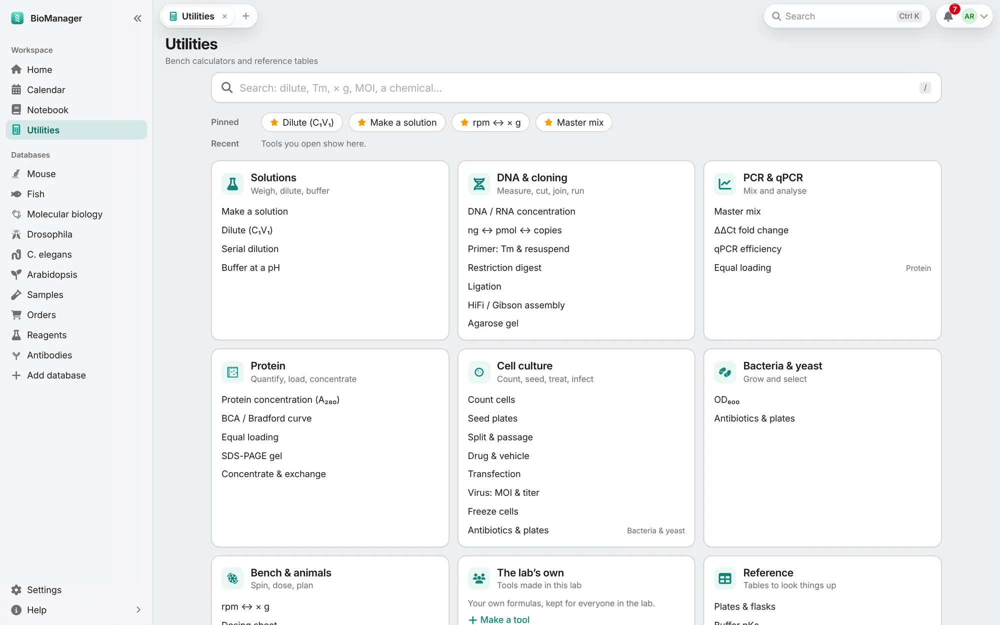
</p>

<p align="center">
  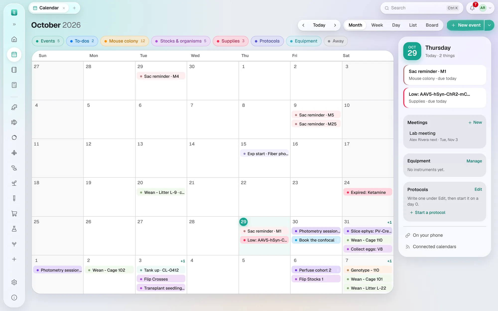
</p>

---

## ✨ Features across the app

<table>
  <tr>
    <td width="50%" valign="top">
      <h4>☀️ A home page that tells you what to do</h4>
      Built from the databases your lab keeps, in the sidebar's order:
      a count for each database, then each one's own cards — <i>Animals
      that may need a look</i> (below), mice older
      than 30 weeks, upcoming weanings and the genotyping queue for the
      colony, zebrafish tanks to return, recent plasmids, and a card of
      its own for each fly, worm or other animal database with what is
      due — then expiring stock, the next 14 days and recent orders.
      Three views, tabs under the greeting (or in <b>Settings →
      Appearance &amp; language</b>), each person's own: <b>Overview</b>
      cards, <b>Timeline</b> (the coming weeks on one row of days, a row
      per kind of work) and <b>By place</b> (your racks from above, with
      the jobs numbered in the order you'd walk the room).
      <b>Customize</b> chooses which cards Overview shows, in what order
      and how wide, and which counts it shows, with your databases,
      to-dos, bookings, recent pages and calculators (the ones you
      opened last) to add.
      <br><br><b>Animals that may need a look</b> says what the records
      show, never a diagnosis: a living mouse whose latest weight is 15%
      or more below its peak of the last 30 days, or below its first
      weight in an experiment (the lab sets the percentage in
      <b>Settings → General → Weight loss to flag</b>); notes on a mouse,
      tank or fish changed in the last 14 days that use a welfare word
      (hunched, lethargic, not eating, wound, 弓背, 消瘦…, with the line
      itself); mice in an experiment measuring body weight not weighed for
      longer than its regimen allows (7 days if it plans no weighing
      days); and mice whose status and experiments disagree. A member sees
      their own animals and experiments (<b>Show the lab’s</b> for the
      rest); animal care, facility managers and admins see the lab's.
    </td>
    <td width="50%" valign="top">
      <h4>📊 Spreadsheet-style editing</h4>
      Click a cell and type; it saves as you go. Every table sorts
      (numbers as numbers: cage 2 before cage 10), filters, exports to CSV
      and prints, and keeps your sort and filter
      (the filter also in its address, for a bookmark). <b>+ Filter</b>
      adds a chip for any column's value (<i>Sex: F</i>), and <b>Save
      view</b> keeps a search, its chips, a sort and the columns shown
      under a name, a tab above the sheet that follows you to any
      computer. <b>Inspector</b> shows the row you click in full beside
      the sheet, a mouse's or cage's rack drawn with its place lit, and
      the initials of anyone else with the sheet open show beside the
      views. Drag a column's
      heading to put the columns you need first (or use the arrows under
      <b>Columns</b>); your order is kept, and an admin sets the lab's
      starting order in <b>Configure</b>. The page scrolls,
      not the table: its search and buttons stay at the top of the window
      and its count at the bottom, with <b>New</b> at the bottom left, which
      adds an empty row at the end to type in (a strain, fish, line, plasmid
      or order, which need a name or a tank first, opens its form). Years of history stay quick:
      mice that died, cages emptied, tubes used up and vials discarded
      more than 90 days ago wait behind <b>Show them</b> at the top of
      the sheet, and are still found by search and in every export. A
      sheet of a thousand rows opens in two or three seconds: the browser
      draws the page you see first, and the rest as you turn to it. A
      sheet of more than 500 entries (an inventory, the mice, cages,
      litters, fish tanks, vials) is paged by the server: it opens with its first page
      and fetches each other page as you turn to it, while search, sorting,
      the chips and the count still cover every entry (<b>Print</b> fetches
      every row first). In
      Chrome, Edge, the Windows app and on Android a sheet's cells are drawn
      as text and become boxes and menus when you click, tap or Tab to them,
      which opens the sheet up to a third sooner.
    </td>
  </tr>
  <tr>
    <td valign="top">
      <h4>➕ Add many at once</h4>
      Describe one mouse and say how many (<code>4 females, 2 males</code>),
      or upload a CSV from the template (Excel's dates are read as
      written). You check an editable preview — IDs included — before
      anything is saved. <b>Fill down</b> (<kbd>Ctrl</kbd> + <kbd>D</kbd>)
      works as in a spreadsheet, and a column of readings pasted into a
      sheet cell fills the cells below (a Nanodrop block steps over the
      unit column, and says which rows it filled).
    </td>
    <td valign="top">
      <h4>↩️ Batch actions with undo</h4>
      Tick rows (shift-click for a range; <kbd>Esc</kbd> lets go) and a
      bar of glass rises: <b>Set field</b> (any
      column, your own included), move them, change owner or status, add
      them to an experiment, sac, retire or delete them. Records you may
      not change are skipped and counted.
      Every bulk action, an import included, can be <b>undone</b> from
      <b>Settings → History</b>. If someone has edited those records since,
      BioManager says so first and offers <b>Undo anyway</b>, so their work
      is never lost without you knowing.
    </td>
  </tr>
  <tr>
    <td valign="top">
      <h4>🗄️ Racks named your way</h4>
      <code>D7</code>, <code>4-7</code>, <code>7D</code>, <code>G12</code>
      or plain 1 to 80. Each rack keeps its own scheme, and a grid shows
      what is where. Change a rack's layout and it asks whether each cage
      keeps its position name or its cell.
    </td>
    <td valign="top">
      <h4>🔎 Search and tabs</h4>
      <kbd>⌘</kbd>/<kbd>Ctrl</kbd> + <kbd>K</kbd> searches everything.
      Every page opens as a tab you can reorder, <b>+</b> opens a new one
      on your start page, and your tabs are still there tomorrow.
    </td>
  </tr>
  <tr>
    <td valign="top">
      <h4>🕓 Full change history</h4>
      Every create, edit and delete is recorded with who and exactly what
      changed (<code>genotype: DBH-Cre → ∅</code>). Admins read it in the
      <b>Audit log</b>, from <b>Settings → History</b>.
    </td>
    <td valign="top">
      <h4>🔐 Sign-in options and reminders</h4>
      Sign in with Google, Microsoft or a password. If your server sends
      email, a daily digest lists what is overdue or coming up for each
      person (<b>Settings → Notifications → Reminder email</b>).
    </td>
  </tr>
  <tr>
    <td valign="top">
      <h4>💬 Feedback, kept in the lab</h4>
      <b>Send feedback</b>, under Help in the sidebar: say what went wrong, an idea or a
      question, from the page you're on. The lab's admins read it and mark
      it done. <b>Also send this to BioManager's makers</b> (ticked in the
      desktop app) sends it to them as well, with a way to reach you if
      you give one, never your name or the lab's records; or <b>Open as a
      GitHub issue</b>.
    </td>
    <td valign="top">
      <h4>📈 A usage report for a pilot</h4>
      Admins find a <b>Usage report</b> on the Feedback page: for each of
      the last eight weeks, how many people changed something and how many
      changes in each area — counts only, no names — to copy into an email.
      It also shows, word for word, the anonymous counts BioManager sends
      its makers once a day, with <b>Switch off</b>.
    </td>
  </tr>
  <tr>
    <td valign="top">
      <h4>🤖 Tell an AI assistant what you did</h4>
      BioManager has no AI inside it, but Claude, ChatGPT, Cursor or another
      assistant you already use can connect to your lab (<b>Help → Connect
      an AI assistant</b>). Tell it what you did, in your words or with a
      photo of your notebook, and it sends one proposal: you <b>Approve</b>
      it whole in BioManager, or <b>Discard</b> it. It never changes
      anything itself, and an approved proposal can be undone like any batch.
      Add the <b>BioManager plugin</b> once (Claude, Codex, VS Code, Qwen Code,
      or download it for Claude, ChatGPT and Kimi Code) and "I want
      to change something in BioManager" is all you need to say.
      At the bench, a <b>Capture</b> (words, dictation or a photo) waits
      for it until later. It can also plan with you: breeding, animals per
      group, random groups, a whole experiment, worked out by BioManager
      from your own records; review the week; draft an experiment's
      methods with its ARRIVE checklist, the animal-use report for your
      annual review (animals per protocol, counted by BioManager), and a
      handover when someone leaves.
    </td>
    <td valign="top">
      <h4>↕️ Your sidebar, your order</h4>
      An admin drags a database up or down right in the sidebar, and the
      order is saved at once (or <b>All databases → Order in the
      sidebar</b>). It is the lab's order, the same for everyone, and Home
      and ⌘1–⌘9 follow it.
    </td>
  </tr>
</table>

### 📥 Coming from Excel

Every database has **Import from Excel**, under **•••** at the end of the
toolbar above its sheet: mice, fish, plasmids, fly and worm vials, any
organism database and every inventory.
Upload the workbook (.xlsx, any sheet), CSV or TSV you kept your records
in, as it is (up to 15 MB and 5,000 rows):

- **Columns are matched by meaning, not just by name.** *Position*,
  *Slot* and *Well* are the position; *DOB* and *Born* the date of birth;
  *Supplier* the vendor; *Cat. No.* the catalogue number. Where a name
  could mean two things the values decide: a *Location* of `A1`, `B2`…
  is a position in a box, one of `Freezer 2` is a location note. Chinese
  headers count too (*性别*, *出生日期*, *笼号*, *质粒名称*), in a CSV
  saved by Excel on a Chinese Windows as well. Each match says why it was
  made, and you can change any of them.
- **The database adjusts to your sheet.** A column BioManager doesn't have
  becomes a new column (text, number or date) in inventories and organism
  databases, if you may configure them, and a mouse sheet's columns are
  matched to the colony's own columns too. Anything else goes into each
  record's notes as `Header: value` (or **Leave out** skips it), so
  nothing is lost.
- **Must-have columns are filled in.** If your sheet has no owner, say who
  every row belongs to (you, by default); for plasmids and stock, whether
  every row is Personal or Lab common (or a *Lab common* column says so row
  by row).
- **Values are tidied.** Excel dates in any style (day or month first,
  decided per column and otherwise by the lab's date style in
  **Settings → General**, `12-May-26`,
  or a date number; a future date of birth is left blank and kept in the
  notes), `Male`/`m`/`♂`/`公` → `M`, your lab's own statuses, people by
  name, a plasmid's `152.6 ng/µl` as its concentration. A cell merged down
  over several rows (a *Cage #* typed once for its mice) counts for each;
  typed once with blank cells below instead, a cage, rack, box or tank
  column offers **Its blank cells take the value above them**, ticked
  (untick it if a blank means none). Cages the import makes belong to
  their mice's owner.
- **You see a preview first.** It runs through the same checks as the
  database's own dialogs and lists every row that would be skipped and why,
  by its row number in Excel. A *Total* line under the records is left out,
  and a mouse whose ID is taken (by the colony or an earlier row) gets the
  next free one, with the preview saying so. The import itself is one
  batch, so **Settings → History** can undo it.
- **Then renumber, if you like.** An inventory record's **#** follows the
  order its rows came in. **•••** → **Renumber** (for the inventory's
  creator or an admin) gives every record the number in its name (*B12*
  becomes #12, when every name has one, none twice and none missing; it
  names the records in the way) or numbers them in the order of a column
  (B2 before B10). It shows each # now and new first; notebook links
  (`@samples 12`) and orders put into stock follow, printed labels keep the
  old # (their QR code still opens the record), and it is one batch to undo.

### 📱 Cage cards that open on your phone

Print correctly sized cards and labels: **Cage cards** on the Cages tab,
**Tank labels** for zebrafish, **Labels** on a fly or worm database, and
**Labels** on ticked samples, reagents or any inventory's rows. Scan the QR code
with any phone camera at the rack and that cage opens, ready to edit —
nobody walks back to a computer to type an ID. On a phone every sheet row
becomes a card with its columns under their names, and rack grids get a
**Move** button: tap a cage, then where it goes.

- **On a phone**: Android has its own app (**BioManager-Android.apk** from
  the download page; **Scan** reads cage cards). On an iPhone or iPad, open
  the lab server in Safari and **Share → Add to Home Screen**: it opens
  full screen like an app, and the camera scans the cards. Phones reach a
  lab server, or a desktop that shares its lab on the network. A bar at the
  bottom of the screen holds **Home**, **Calendar**, **Databases**,
  **Notebook** and **Scan**, with **Search** beside it.

- **Label printers**: **Print on** chooses a sheet of cards for any
  printer, or a label printer's roll — Brother QL (62 × 29, 90 × 29,
  100 × 62 mm), Zebra (2 × 1, 3 × 1, 4 × 2, 4 × 2.5 in) or cryo-tube
  labels — and prints one label a page, typed to fit. Each person's
  choice is remembered.
- **What each label says**: for tubes, **On each label** chooses the
  fields (box, position, lot, a column such as concentration, the day
  printed…), remembered for each database, and **Two lines for long
  text** wraps a cryo label's name and place instead of cutting them.
- **Zebra**: **Download for Zebra (.zpl)** gives the labels in the
  printer's own language. Or an admin adds the Zebra's address once,
  under **Send labels straight to a Zebra on the network**, and **Send to
  Zebra** prints them straight away.

<table>
  <tr>
    <td width="62%" valign="top">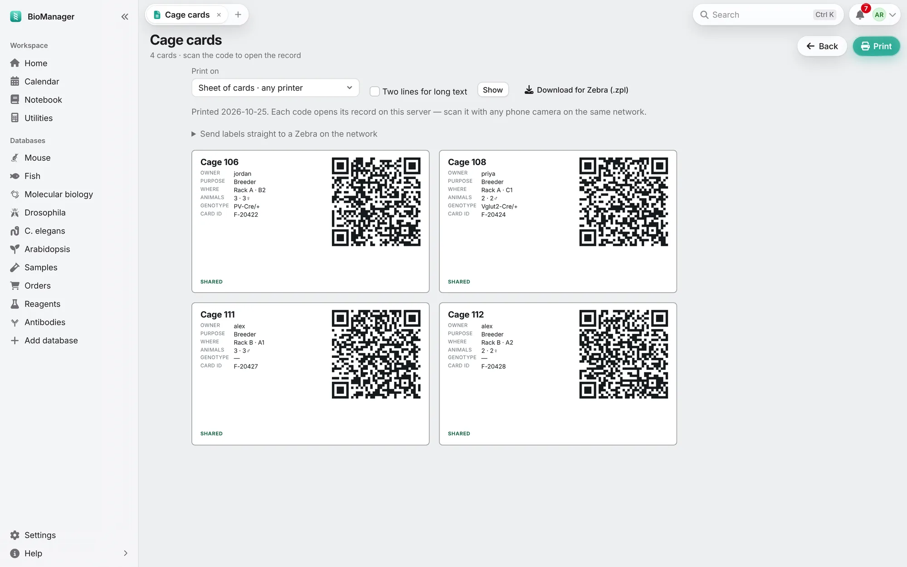</td>
    <td width="19%" valign="top">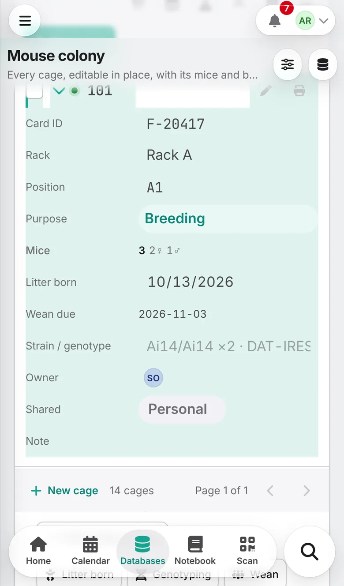</td>
    <td width="19%" valign="top">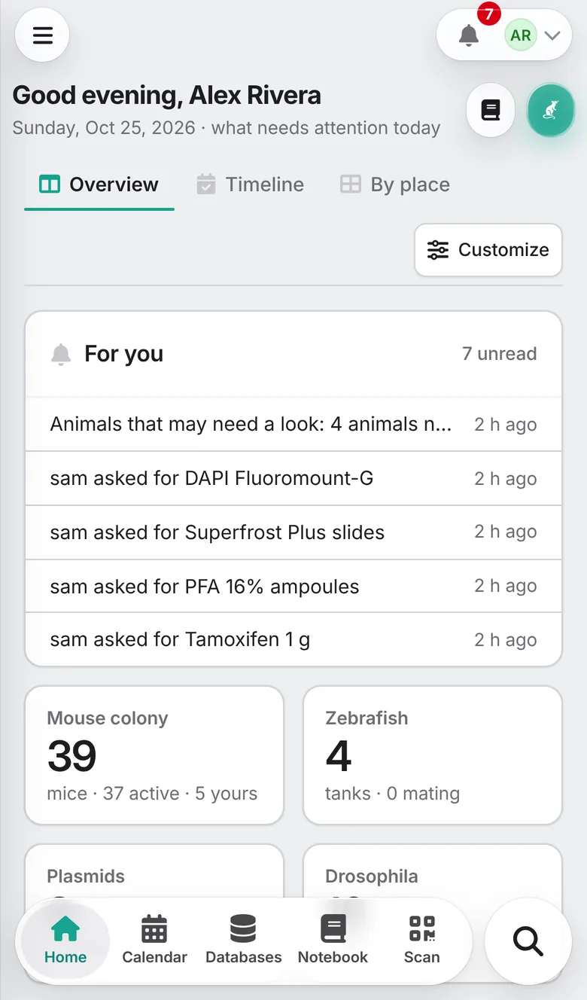</td>
  </tr>
  <tr>
    <td align="center"><sub><b>Print</b> the cards</sub></td>
    <td align="center"><sub><b>Scan</b> one…</sub></td>
    <td align="center"><sub>…or check <b>Home</b></sub></td>
  </tr>
</table>

### 🌗 At home on a Mac, and in the dark

The interface follows Apple's Liquid Glass design, over a softly tinted
wallpaper: the sidebar, the row of tabs and each page's buttons float as
clear glass over the page, which scrolls beneath them; cards are a thicker
glass, and sheets and notebook pages the thickest, so the records stay as
easy to read as paper. On a Mac the desktop app has no title bar; its close,
minimise and zoom buttons sit at the top of the sidebar, followed, as in
Safari, by buttons to hide the sidebar, search everything, and go back and
forward. The sidebar starts narrow, a column of icons: hover one to see its
name, or hover a database to look inside it (how many records, what is due,
the latest ones) without leaving the page. There is a full
dark mode, following the system's setting (in the desktop app, **View →
Appearance** chooses Light or Dark), and Reduce Transparency, Increase
Contrast and Reduce Motion are honoured. It works in any modern browser on
Windows and Linux too.

Text is set in Geist, which tells I, l and 1 apart in IDs and genotypes and
looks the same on every computer, with each system's own Chinese font.
**Settings → Appearance & language → Font** switches to Inter or the computer's font,
and **Text size** makes everything smaller or larger in the Mac app.

**Settings** is laid out like the Mac's System Settings: a list of panes
on the left (**You**: Profile, Sign-in & security, Appearance & language,
Notifications, AI assistant & tokens, Your data; **Lab**: Statistics,
General, Databases, People & access, Devices & copies, History) and the
chosen one beside it, its settings in grouped rows with a short line on what
each does. A change is saved as it is made, and the search box at the top
finds a setting by name. Your **Short name** under Profile (up to 5
letters, THX) is what your round badge says, at the top right and on your
records; without one it shows your initials. The lab's panes hold its setup and its admin
pages: everyone sees them, admins change them. **Statistics** counts the lab's mice, fish tanks and fly and worm
vials, by person, and shows how full each rack and box is.

Each person can pick their own app icon in **Settings → Appearance &
language**: a double helix,
mouse, zebrafish, *C. elegans*, *Drosophila*, cryobox, microtube or petri
dish, in one of six macaron colours. The browser tab and sidebar show it,
and the app's accent colour follows it.

### 🌏 English or 中文

BioManager is in English and Simplified Chinese. It follows the language a
person's computer or browser asks for first (the desktop app, the computer's);
each person can choose for themselves in **Settings → Appearance & language**, which
changes as soon as they pick, or with the **中文 / English** switch on the
sign-in page, which stays their choice once they sign in. Every page is in both: each database, the calendar, the
notebook and experiments, Settings and the lab's panes in it, and the messages and
notifications, which reach each person in their own language. Names, notes
and everything people type stay as written, and so do exports, labels and the
API. The website has a Chinese version too, at [biomanager.org/zh](https://biomanager.org/zh/).

<table>
  <tr>
    <td width="50%"></td>
    <td width="50%">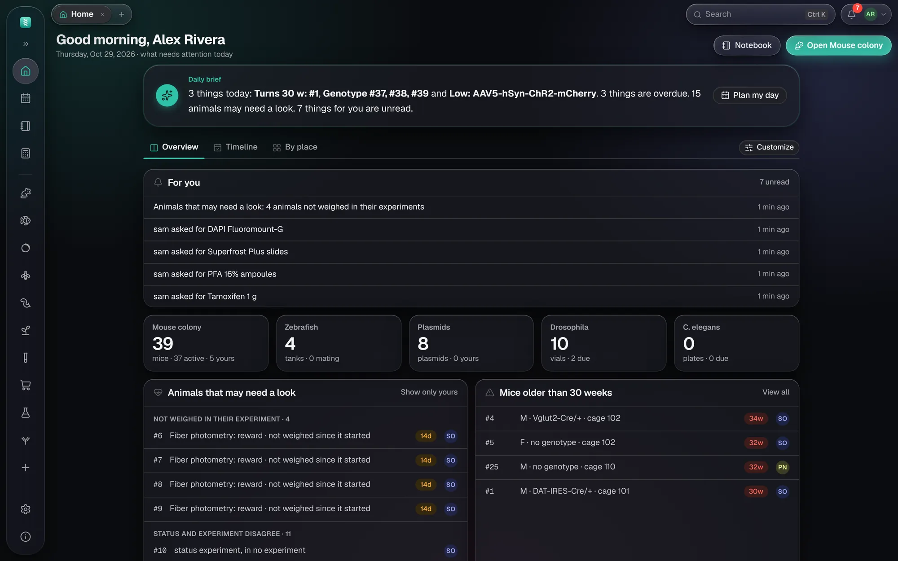</td>
  </tr>
</table>

---

## 🚀 Ways to run it

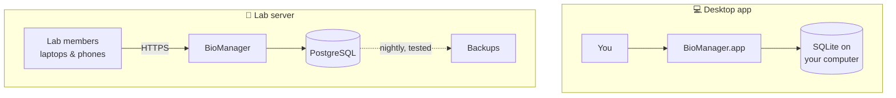

| | 💻 Desktop app | 🏫 Lab server | 🛠️ From source |
| --- | --- | --- | --- |
| **For** | one person, one computer | a whole lab, from any browser | developers |
| **Database** | SQLite, on your computer | PostgreSQL | SQLite (or PostgreSQL) |
| **Setup** | download and open | the desktop app sets it up for you (or Docker by hand) | Python 3.11+ and Node |
| **Backups** | `dbtool.py backup` | automatic, nightly, test-restored weekly, optional off-site copy | `dbtool.py backup` |
| **Phones & QR codes** | — only your computer, unless it shares its lab on the network | ✅ | on your local network |

> [!NOTE]
> Start on the desktop and move to a server later: **Set up a lab server**
> in the desktop app can bring this computer's records along (by hand,
> `scripts/migrate-to-postgres.py` carries an existing database across).

### 🔁 One lab, many devices

One device holds the lab's **master copy**; every other one works on it
through its address, so nothing is ever merged and nothing written in two
places is lost. **Settings → Devices & copies → Devices** says which device it is and lists
every computer linked to the lab:

- **A lab server** is the master copy unless an admin hands it on.
- **A desktop joins the lab as one of your devices** (**Open your lab**, or
  **Open the lab in this window**): you sign in as you do at the lab (or
  approve a code on a device already signed in), and its window works on the
  lab through the app, never the server's page itself. It keeps a daily
  copy, locked with the lab's key and its own. **Go → This Computer's
  BioManager** and **Go → Your Lab's BioManager** switch between the two.
- **A desktop can share its own lab on the network** (**Share this lab on
  the network**, admins): it becomes the master for every device on the same
  network (Wi-Fi or cable), which opens its address. The computer must
  stay on, and the connection isn't encrypted, so only on a network you
  trust.
- **An admin can hand the master copy to a linked desktop**
  (**Make it the master**, for a computer with an admin's key, open, on the
  same version). It takes a last copy, keeps its own data as a backup,
  and shares the lab on its network; the old master turns read only and
  sends everyone there. **Give the master copy back** returns it, with
  everything changed meanwhile. Sign-ins to other services (Google
  Calendar) are not carried along and are connected again.

Every computer, phone and browser you are signed in on is one of **Your
devices** (**Settings → Devices & copies**): rename one, or **Sign out**
one (a lost phone) without changing your password. Admins see everyone's.

### 📴 Working offline in the facility

Animal facilities often have no signal. The Android app and the desktop app
keep a copy of what you need there (the colony's racks, cages, mice, litters
and recent weights, your to-dos for two weeks, vials and tanks, as you may
see them), refreshed when they open, when the network comes back and every
15 minutes; **Get ready for the facility** (hold the Scan button) takes a
fresh one. When the server can't be reached, the app shows offline screens
instead of an error: find a cage by its ID or card, or scan it, and **Record
a weight**, **Died**, **Move**, **Note**, **Litter born**, **Genotyping**,
**Wean**, tick a to-do, flip or discard a vial. A Breeding cage lists each
litter not yet weaned, and Litter born, Genotyping and Wean ask which, as the
pages do. Each shows at once, marked *waiting*. Back in signal the changes reach the lab in the order you made
them, through the pages' own rules, as you. One that clashes with a change
made meanwhile (the same field, set to something else) waits under **Needs
your decision** (**Keep mine**, **Keep theirs**, **Edit**); a different
field is kept along with yours; one the lab refuses is listed with the
reason.

---

## 🏁 Getting started

### 💻 Desktop app

1. Download BioManager for your system from the
   [**BioManager website**](https://biomanager.org/download.html),
   or build it yourself (below).
2. **macOS:** open the download and drag BioManager into Applications.
   The first time, macOS won't open it: choose **Done**, then
   **System Settings → Privacy & Security → Open Anyway** (before macOS 15,
   right-clicking the app and choosing **Open** is enough). **Windows:**
   extract the zip, open the BioManager folder and run `BioManager.exe`;
   at the warning choose **More info → Run anyway**. **Linux:** mark
   `BioManager-Linux.AppImage` executable and open it. The apps aren't
   signed by Apple or Microsoft, so the system asks once per version.
3. It asks whether your lab already uses BioManager. **Yes, open my lab**
   takes the lab's address, then your sign-in, and joins the lab as one of
   your devices; nothing is made on the computer. **No, start a new lab** names the new lab, asks where it
   lives, and makes your account its admin; then answer the short setup
   survey: tick what your lab keeps, and BioManager creates just those
   databases, with racks and incubators to match, and shows the address
   people join at. Home then shows a **Getting started** list of first
   steps. Before moving a
   real colony in, the guide's
   [*Try it first*](https://biomanager.org/guide/try-it-first.html) walks
   through a practice rack, a litter and its weaning date, then throws it
   away.

On a Mac the app has a full menu bar: **File** (New Tab ⌘T, Close Tab
⌘W, Export This Sheet ⇧⌘E, Print ⌘P), **Edit** (the usual editing
commands and Search BioManager ⌘K), **View** (Reload ⌘R, zoom, Light or
Dark whatever the system uses, Full Screen), **Go** (Back ⌘[, Forward ⌘],
Home ⇧⌘H, next and previous tab ⇧⌘] ⇧⌘[, and everything in your sidebar,
the databases on ⌘1 to ⌘9), **Window** and **Help** (the user guide,
keyboard shortcuts, what's new, report a problem). **Settings…** is ⌘,.
On Windows and Linux the same destinations are in File, Go and Help.

**Check for Updates…** (in the BioManager menu, or Help on Windows and
Linux) asks GitHub for the latest release and, if it is newer, shows
what's new. **Install and Restart** downloads it, checks it against the
checksum GitHub publishes, and swaps it in as the app quits (the old one
is kept until the new one opens); where it can't (the Linux .tar.gz, a
folder it can't write to), it opens the download in your browser. The
app also checks by itself, at most once a day; turn that off with
**Check for Updates Automatically**. The check sends nothing but the app's
version.

A **lab server** looks for a new version once a day and tells its admins
(a notification, and **Settings → Version**, with
what's new and a link to the release notes). **Update now** there takes a
backup, downloads the new version, checks it against the checksum GitHub
publishes, installs it and restarts the server; BioManager is away for a
minute or two and the page comes back on the new version. It needs the
server's helpers installed once (`sudo host/install.sh`, which every set-up
route runs); without them the pane says so, and the runbook's "Updating
the app" does the same by hand. The check sends only the server's version;
turn it off there, or for the server with `BIOMANAGER_UPDATE_CHECK=0`. The
phone apps open the server, so they are always on its version.

After an update (the desktop app's, or the lab server's), the first page
each person opens shows a short **What's new**: what is new, what works
differently and what was fixed, with a link to the full release notes.
**Got it** closes it for good; **Help → What's new** opens it again.

The window keeps you signed in and keeps your tabs from one launch to
the next, as a browser does.

On Windows the window is Microsoft Edge WebView2, which Windows 11 has. A
Windows 10 PC without it gets an offer to download it from Microsoft, and
BioManager opens in the web browser meanwhile (leave its message open while
you use it); once it is installed, BioManager opens in its own window again.

Your data lives outside the app, so updating or reinstalling never
touches it:

| System | Data folder |
| --- | --- |
| macOS | `~/Library/Application Support/Biomanager/` |
| Windows | `%APPDATA%\Biomanager\` |
| Linux | `~/.local/share/Biomanager/` |

<details>
<summary><b>Build the desktop app yourself</b></summary>

```bash
./scripts/build-desktop.sh
open dist/BioManager.app
```

This produces `dist/BioManager.app` on macOS, or `dist/BioManager/` on
Windows and Linux.
</details>

### 🏫 Lab server

**The easy way: let the desktop app do it.** In the desktop app, choose
**Set up a lab server** (when you start a new lab, or in **Settings → Devices &
copies**) and say where it should run:

- a cloud server reached privately over **Tailscale** (recommended; Oracle's
  free tier is enough), or one with the lab's **own web address**;
- a **university or department server**;
- a **Linux computer in the lab** (a NAS with Docker, such as one running
  fnOS, will do), or **this computer** if it has Docker.

It signs in over SSH with your key, or with the account's password if
you have no key (as on a NAS: under **SSH key**, choose **No key: sign in
with a password**), and asks for a password for sudo too when the account
needs one; passwords are used for that one run and never saved. It
installs Docker (and Tailscale) if needed, downloads the release's server
bundle, writes its settings with a fresh database password, can bring the
desktop app's records along, starts it (on ports 80 and 443, or others it
finds free when the machine already uses those, as a NAS's own web pages
often do), sets up alerts and backups, and checks that it answers. Every
step and every command is shown before and while it runs; at the end you
get the address and the setup code for the admin account.

**A lab already in the desktop app** goes to a new server whole: in the
desktop app, **Settings → Devices → Move this lab to a server**, with the
server's address and setup code. Records, accounts and uploaded files go
there; the desktop then opens the server and keeps a daily copy, and its
own lab stays as it was, read only (**Use this computer's own lab again**
brings it back). A server it can't reach takes the lab as a file instead:
**Save the whole lab** on the desktop, then **Bring a lab from the desktop
app** on the server's *This server has no lab yet* page. To start a
server's lab over, `deploy/RUNBOOK.md` has a script that sets the lab
aside (and puts it back).

**By hand:** the supported setup is the Docker stack in [`deploy/`](deploy/README.md):
HTTPS, PostgreSQL, and a backup service that dumps the database every
night, checks each dump and test-restores one every week.

```bash
git clone <this repository> biomanager && cd biomanager/deploy
cp .env.example .env && chmod 600 .env     # set DOMAIN, POSTGRES_PASSWORD, TZ
host/ports.sh                              # 80 and 443, or free ones if those are taken
docker compose up -d --build
docker compose logs app | grep "setup code"
```

Open `https://<your domain>/register` (with the port, such as `:4443`, if
`host/ports.sh` chose other ones) and create the first account with the
**setup code** from the log. That account is the admin; signing in, it
answers four questions about the lab, and BioManager sets itself up to
match.

> [!IMPORTANT]
> Keep the server off the open internet: on the campus network, a VPN, or
> a private network such as Tailscale — `deploy/README.md` walks through
> it. [`deploy/RUNBOOK.md`](deploy/RUNBOOK.md) covers what to do when
> something goes wrong.

<details>
<summary><b>🛠️ Run from source</b></summary>

```bash
python3 -m venv .venv && source .venv/bin/activate
pip install -r requirements.txt
(cd frontend && npm install && npm run build:css)
PORT=5055 python run.py
```

Open <http://127.0.0.1:5055> (on macOS, AirPlay holds port 5000). The
first account needs the setup code printed in the terminal.

Want something to click around in? `python scripts/demo-data.py
/tmp/biomanager-demo` builds a made-up lab — the one in these
screenshots — and `BIOMANAGER_DATA_DIR=/tmp/biomanager-demo python run.py`
opens it.
</details>

---

## 📆 A first week with BioManager

A walk-through for a mouse colony. The other modules work the same way.

<table>
  <tr>
    <td valign="top" width="25%">
      <h4>Day 1 · Set up</h4>
      <ol>
        <li>Sign in as the admin; approve colleagues in <b>Settings → People &amp; access</b>.</li>
        <li><b>Mouse colony → Cages → Rack grid → New rack</b>, labelled like the stickers on your real racks.</li>
        <li>Add your lines under <b>Strains</b>.</li>
      </ol>
    </td>
    <td valign="top" width="25%">
      <h4>Day 2 · Bring the mice in</h4>
      <ol>
        <li><b>Mice → ••• → Import from Excel</b>: upload your old spreadsheet as it is and check how its columns were matched.</li>
        <li>Or <b>Mice → Add many</b>: describe a group of new mice.</li>
        <li>Check the preview; <b>Fill down</b>, <b>Skip</b>, then save.</li>
        <li>Give each cage a purpose and a rack position.</li>
      </ol>
    </td>
    <td valign="top" width="25%">
      <h4>Day 3 · Label the rack</h4>
      <ol>
        <li><b>Cages → Cage cards → Print.</b></li>
        <li>One card per cage.</li>
        <li>From now on, on a lab server, a phone camera opens any cage.</li>
      </ol>
    </td>
    <td valign="top" width="25%">
      <h4>Every day after</h4>
      <ol>
        <li>Open <b>Home</b>: weanings, genotyping, old breeders, low stock.</li>
        <li>Click an item to go straight to it.</li>
      </ol>
    </td>
  </tr>
</table>

<details>
<summary><b>🍼 When a litter is born</b></summary>

Open the breeding cage, choose **Litter born** and confirm the date of birth
(today unless you change it). The weaning and
genotyping dates appear on Home and the calendar when they come due. At
weaning, add the pups with **Add many** and move them to their new cages.
If the cage's last litter isn't weaned yet, say whether this is
**Another litter** (both are kept, each with its own dates) or
**Correct the date**.
</details>

<details>
<summary><b>🧪 When an experiment starts</b></summary>

Tick the mice on **Mice** (shift-click selects a range). In the bar that
rises from the bottom, choose **Add to experiment** and name the treatment
group. On the experiment, list each injection, challenge or weighing day
under **Regimen**, then **Record manipulation** as each is done: a dose
per body weight is worked out from each animal's latest weight. **Add to
notebook** puts all of it in a notebook page.
</details>

<details>
<summary><b>↩️ When you make a mistake</b></summary>

Open **Settings → History** and undo the bulk action. For a single
edit, the change history shows what the value used to be.
</details>

<details>
<summary><b>🦎 When you need a new kind of database</b></summary>

Choose **Add database**, pick a preset (Drosophila, C. elegans, zebrafish,
mouse, plants, field crops) or start blank, name things your way and choose
what it needs to track.
</details>

<details>
<summary><b>⌨️ Keyboard shortcuts</b></summary>

| Keys | Does |
| --- | --- |
| <kbd>⌘/Ctrl</kbd> + <kbd>K</kbd> | Search everything |
| <kbd>⌘/Ctrl</kbd> + <kbd>B</kbd> | Show or hide the sidebar |
| <kbd>Alt</kbd> + <kbd>1</kbd>…<kbd>9</kbd> | Switch to tab 1 to 9 |
| <kbd>Alt</kbd> + <kbd>←</kbd> / <kbd>→</kbd> | Previous / next tab |
| <kbd>Alt</kbd> + <kbd>W</kbd> | Close the current tab |
| Middle-click a tab | Close it |
| <kbd>Shift</kbd>-click a row | Select a range |
| <kbd>⌘/Ctrl</kbd> + <kbd>D</kbd> | Fill down, in the mice's **Add many** preview |
| <kbd>Esc</kbd> | Close a menu or dialog |
</details>

---

## 👥 Accounts, permissions and privacy

- **The first page is the lab's sign-in**: its name and what it keeps on
  one side, the form on the other. **Remember me on this computer** offers
  the account by name next time. **Ask to join** sends a new person's
  request to every admin, and their page changes the moment one approves;
  a visitor enters a **guest code**, or, without one, asks the lab's
  admins for one (a notification to each of them, as **Forgot your
  password?** is). Before there is any account, it starts a lab instead:
  on a server it says it has no lab yet; the desktop app first asks
  whether the lab already has a BioManager to open.
- **The first account is the admin.** On a server it needs the setup code,
  so nobody else on the network can claim it first.
- **New sign-ups wait for an admin's approval**, under **Waiting to join**
  in **Settings → People & access**; **Approve** lets them in.
- **A lab nobody can sign in to on the desktop app** (the admin's password
  lost, or someone else made the first account): **Start a new lab** on the
  sign-in page (or **Settings → Lab**) sets it aside in the data folder
  under `old-labs`, deleting nothing, and the next start begins an empty
  lab whose first account is the admin. **Bring back a lab set aside**
  lists them and brings one back, setting the present lab aside in its
  place, so either step can be undone.
- **You edit what you own.** Your mice, cages and records are yours.
  **Shared cages and anything marked lab common belong to the whole lab.**
  A Breeder cage starts out shared; any other cage starts personal. Only a
  cage's owner or an admin shares it, makes it personal or gives it away.
  The same goes for everything with an owner, in every database: editing
  a shared breeding tank, a lab stock vial or a lab-common plasmid doesn't
  make it yours to give away (animal care may, for the animals, cages,
  tanks and vials they look after), and a new owner must be someone in
  the lab, picked from the list.
  Admins can change anything, and when a record isn't yours, BioManager
  says whose it is. **Racks & boxes**, in **Settings → Statistics**, says
  who may change each rack, box and incubator.
- **Project groups.** Some of the lab working on one project can be a
  group (**Settings → People & access → Project groups**): an admin makes
  it, and an admin or the group's leads add and remove people; someone can
  be in several groups. Each person in a group is a **Lead**, a **Member**
  or **Can only view**, and the group's switches say what its members may
  do: edit what is shared with it, add and change records in its
  databases, edit each other's records there, edit its notebook pages,
  tick off its to-dos, and share their own things with it. They start as
  groups always worked. Wherever something can be shared with the lab, it can
  be shared with one of your groups instead: a cage, a breeding tank or a
  lab stock vial is then its members' to edit (as the group allows), as is a plasmid
  or reagent shared with it (everyone still sees them). A database made
  for a group is seen only by its members (and admins), a group's to-dos
  are on their calendars for any of them to tick off, and a notebook page
  or template can be shared with a group. The colony's **My groups** view
  shows the mice and cages of everyone in your groups. Deleting a group
  makes what was shared with it its owner's own again (a breeding tank or
  stock vial the lab's).
- **Roles for a facility** (Settings → People & access, the **···** beside someone): **Animal care**
  (technicians, vets) may change any lab's animals, cages, tanks and
  vials, but not other people's experiments, notebook pages or settings
  (their own they keep like a member); a **Facility
  manager** also runs the racks, rooms, incubators, water systems and
  databases' settings, but not accounts.
- **Sign in with your institution.** Besides Google and Microsoft, a
  server can offer the institution's own sign-in (any OpenID Connect
  provider: Okta, Keycloak, Azure AD, Shibboleth's OIDC plugin), or a
  university that only speaks SAML (InCommon, eduGAIN) through CILogon
  (deploy/README.md).
- **Everyone sees every lab database** — a census with holes is not a
  census. The **My colony / My groups / Shared / Everyone** switch filters
  the view without changing who may edit what.
- **The lab sees only what it uses.** On first sign-in the admin answers
  four questions: the lab's name, time zone and how dates are written;
  which databases it keeps; which functions it uses (the calendar, the
  notebook); and what members may do. Everyone then gets exactly those, in the sidebar and on their home
  page. **Settings → General** and **Databases** change it any time and
  switch things off (hidden, never deleted); **People & access** makes
  someone else an admin and says what members may do. Members see these
  panes too, read only.
- **Your own databases.** Anyone can add a database **just for them**, which
  only they and the admins see, or for one of their project groups, and
  share it with a group or the lab later. Admins add databases for the
  whole lab, and decide whether members may too.
- **Notifications.** The bell tells you when someone moves or gives you
  animals, picks from your breeders, records a genotype for yours, writes
  @you in a note or a notebook comment, or when an order you placed is
  ordered, received or cancelled; admins hear of each new order request.
  Once a day it also says how many animals may need a look (losing
  weight, not weighed in an experiment, notes with a welfare word): your
  own, or the lab's for animal care, facility managers and admins.
  Choose which kinds in **Settings → Notifications**. New members get a
  short welcome tour (**Settings → Your data → See the welcome tour
  again**).
- **Guests.** An admin can let someone outside the lab in for a day to 30
  days with a **guest pass**: a one-time code instead of a password, an
  account that stops working when the pass ends, and nothing they can do
  to the lab's setup or other people's records. **New guest pass**, under
  Guests in **Settings → People & access**, makes one, and **End now**
  stops it early. From the internet, someone not signed in only ever sees
  the page for entering a code.
- **When someone leaves,** **Settings → Statistics** shows how many
  animals each person keeps and how full each rack and box is, and the
  admin hands their racks to someone else there. **Set field → Owner** on
  each sheet puts their records in someone else's name, and **Disable the
  account** (the **···** beside them in **Settings → People & access**)
  closes it; their records and history stay. An AI assistant can write
  the handover first: everything in their name, by rack and box, with
  what is due on it in the next 30 days.
- **An API for scripts and instruments.** **Settings → AI assistant & tokens**
  makes a token for R, a Python script, a balance or another tool; it
  reads the lab's records as JSON, or changes them, as you and with your
  permissions (*Read*, or *Read and change*; it can expire, and you or an
  admin can revoke it). Mice, cages, litters, strains, tanks and fish,
  plasmids, fly and worm vials, every inventory and every experiment can be
  read; a mouse's weights and fields, vials, inventory items and an
  experiment's readout can be written. A list refuses a filter it doesn't
  take, and names the ones it does. A plasmid comes with its box, position
  and the glycerol stocks that carry it, and its DNA sequence and map only
  when asked (`?sequence=1`); a litter names the cage its pups are in, and
  `/api/v1/litters?cage=88` lists a cage's litters. For tools that start from your
  own words, such as an AI assistant, it also finds the records a phrase
  means (`/api/v1/resolve`), lists what the lab calls things
  (`/api/v1/vocabulary`) and what is due (`/api/v1/due`), searches
  (`/api/v1/search`), reads a record's history and family tree, and works
  things out from the lab's own records, changing nothing: animals available,
  a breeding plan, random groups, animals per group, when stock runs out, the
  week's checks (with the animals that may need a look), an experiment's facts for its methods, a derived readout
  (a tumour volume, ΔΔCt, fold change) from raw measurements, a plate reader's or qPCR export read onto an
  experiment's plate layout (`/api/v1/experiments/<id>/plate`), the animals used
  per protocol over a year (`/api/v1/animal-use`) and everything one person
  looks after (`/api/v1/handover`: your own, or an admin's of anyone). A *Read and
  propose* token, meant for an AI assistant, changes nothing itself: it
  sends its changes as one proposal, which BioManager checks as its pages
  would and keeps under **Proposed changes** (in your account menu and in
  **Settings → AI assistant & tokens**, with a notification) as one plain summary, with warnings
  for what else a change would do (a cage no longer shared with the lab, an
  item of that name already in stock). To fix what is there it changes it
  rather than adding another: a notebook page's title, kind, tags or text
  (all of it, or a few parts: a protocol's steps made a checklist for **Run**),
  with each change shown before and after and the old text kept in the
  page's **History**, never on a signed page or one someone has open; a
  protocol filed in a folder of **Protocols**; an inventory renumbered. It
  reads a page's current text first (`/api/v1/notebook/pages/<id>`). **Approve** makes every change at
  once, as one batch you can undo; **Discard** makes none; only you, signed
  in, can approve, or **Send back** with a reason for the assistant to
  correct: its corrected proposal takes the old one's place. **Connect an AI assistant**, at the top of the same
  pane, connects one (it is also under **Help**). Claude Code, Codex, Cursor,
  VS Code and Cherry Studio use BioManager's own MCP address (`/api/v1/mcp`),
  nothing to install: paste the page's message into the assistant and it sets
  itself up, or press **Add to Cursor**, **Add to VS Code** or **Add to Cherry
  Studio**, then you sign in in the browser (or use such a token); Claude
  Desktop runs `mcp/biomanager_mcp.py` from this repository
  (`mcp/README.md`). On a lab server that is on the internet, claude.ai,
  the Claude phone apps and ChatGPT add the same address as a custom
  connector and sign in with a one-time connection code. The **BioManager
  plugin** (`plugins/biomanager/`, added from the `gaspolymerase/biomanager`
  marketplace in Claude, Codex, VS Code or Qwen Code, or from each
  release's `BioManager-plugin-Kimi.zip` in Kimi Code) teaches an
  assistant how to work with BioManager, so nobody has to explain it first.
  Changes are in the change history
  under your name, marked with the token's name. The reference, with
  examples in curl, Python and R, is at `/api` on your BioManager
  (`/api/v1/openapi.json` for tools that read OpenAPI). **Members may make
  API tokens**, under **What members may do** in **Settings → People &
  access**, can keep them to admins.

  ```bash
  curl -H "Authorization: Bearer $BM_TOKEN" "https://your-server/api/v1/mice?alive=true"
  ```
- Passwords are at least 12 characters, repeated failed sign-ins are
  locked out, and changing a password (**Settings → Sign-in & security**)
  signs out every other session. A forgotten password is reset by an
  admin, from the **···** beside you in **Settings → People & access**.
- **Your data stays with you** — on your computer or your lab's server.
  None of it is sent anywhere unless you connect Google Calendar, put the
  calendar in your Mac's Calendar (which passes it to that account), Google
  or Microsoft sign-in, or reminder emails, or a tool you gave a token asks,
  or you leave **Also send this to BioManager's makers** ticked on a
  feedback note (then that note goes, with its page and version).
- **Anonymous counts, once a day.** BioManager is free; these counts are
  how its makers can show that labs rely on it and see which parts to
  improve first. Each installation sends one short message a day: the
  version, desktop app or server, the operating system and database, how
  many members and how many were active this week (as ranges: 1, 2–5,
  6–15, 16–50, 51+), which built-in functions are on and how many databases
  of each kind, and a random id for the installation. Never names, email
  addresses, anything anyone wrote, what your databases are called, or the
  computer's name or address. It goes to PostHog, which is asked not to
  work out where it came from. They are on unless an admin switches them
  off, in **Settings → General** (**Share anonymous counts with
  BioManager's makers**) or on the **Usage report** (**Help → Send
  feedback → Usage report**), which shows exactly what is sent; the setup
  survey says so. On a server, `BIOMANAGER_TELEMETRY=0` or
  `DO_NOT_TRACK=1` turns it off for good.

## 💾 Your data and backups

> [!WARNING]
> **Don't keep the database in a cloud-synced folder** (OneDrive, Dropbox,
> Google Drive, iCloud Drive). Syncing corrupts SQLite files. BioManager
> warns you at startup if it spots this.

**Save the whole lab** (**Settings → Your data**, admins) puts every
record, account and uploaded file in one `.biomanager` file: a backup to
carry, and the way to bring the lab to another computer (a new desktop
app's first page: *Bring a lab file here*) or to a new server.

On a single computer, back up BioManager's data folder
(`~/Library/Application Support/Biomanager/` on a Mac,
`%APPDATA%\Biomanager\` on Windows, `~/.local/share/Biomanager/` on
Linux) with Time Machine or File History. To put a backup back, quit
BioManager, move `data/biomanager.db` aside and put the backup in its
place (the guide's
[*Restore a backup*](https://biomanager.org/guide/restore-a-backup.html)
says how). Running from source, `scripts/dbtool.py` does the same:

```bash
python scripts/dbtool.py check                      # where is it, is it healthy, is it at risk
python scripts/dbtool.py backup                     # a consistent snapshot; keeps the last 30
python scripts/dbtool.py relocate ~/BioManagerData  # move it somewhere safe
python scripts/dbtool.py restore <file>
```

**Upgrading is safe.** Before a new version changes a database an older
one made, it copies it (`backups/before-upgrade-….db` in the data folder;
the last ten are kept), and every release is tested opening a demo lab
made by each earlier release, with nothing lost. To go back, close
BioManager, put that copy in place of `data/biomanager.db` and open the
version it came from. A lab server takes a backup before every update.

A lab server backs itself up every night, checks every backup and
test-restores one every week, with an optional off-site copy and a nightly
copy on the admin's Mac. A desktop app that joins the lab keeps **a copy of
the lab** on that computer (**Settings → Devices & copies**; a computer that
shouldn't join can use a key from the server instead): checked when it
arrives, refreshed daily, the newest 14 kept, and loadable into a new server
if the old one is lost. Admins decide whether members may (guests never). An
admin's copy is the whole lab; a member's holds what they can see in the
app, without anyone's password, other people's private notebook pages,
personal databases, personal to-dos and events, or the Audit log.

**The lab's key** locks the server's backups, **Save the whole lab** files
and the copies on computers, so a file that leaks can't be read. The server
and its admins' desktop apps hold it and open these files for you. Its
**recovery key** (**Settings → Your data → Lab key → Show the recovery key**,
admins) is the one way to open a backup if the server and every admin's
computer are lost: keep it on paper or in a password manager, away from the
backups. **Settings → Your data → Export my data** downloads your own mice, cages,
weights, experiments, plasmids (each sequence as a GenBank file, with its
features), notebook pages and profile as a zip at any time.

---

## 📚 Documentation

| Document | For |
| --- | --- |
| [**User guide**](https://biomanager.org/guide.html) | Using BioManager, step by step: setting up a lab, every module, phones, backups. Also under **Help** in the app's sidebar |
| [`deploy/README.md`](deploy/README.md) | Setting up a lab server: HTTPS, Tailscale, Google/Microsoft sign-in, backups, updates |
| [`deploy/RUNBOOK.md`](deploy/RUNBOOK.md) | Running a lab server: alerts, outages, restores, people joining and leaving |
| [`docs/GOOGLE_CALENDAR_SETUP.md`](docs/GOOGLE_CALENDAR_SETUP.md) | Connecting Google Calendar |
| [`docs/DEVELOPMENT.md`](docs/DEVELOPMENT.md) | How BioManager is built: stack, styling, icons, the organism engine, access control, audit and undo, tests, security settings |
| [`docs/TESTING.md`](docs/TESTING.md) | How 1.0 was tested: six areas stress-tested like a lab and an attacker would, what was found and fixed, and the full reports |

Working on BioManager itself? Start with
[`docs/DEVELOPMENT.md`](docs/DEVELOPMENT.md). The test suite runs on SQLite
and PostgreSQL with `scripts/test.sh`, on every push. To refresh these
screenshots, see `scripts/screenshots.py`.

## 🙏 Licence and credits

BioManager is released under the [MIT licence](LICENSE). If you use it in
your research, **Cite this repository** on the GitHub page gives the
citation in APA or BibTeX (from [CITATION.cff](CITATION.cff)).

Built with Python, Flask, SQLAlchemy, PostgreSQL / SQLite and Tailwind CSS.
Icons from [Lucide](https://lucide.dev) (ISC licence); the fly, plasmid,
petri dish, cage, tank, culture-vial, organ and other lab icons were drawn
for this project in its style. Text is set in
[Geist](https://vercel.com/font) (SIL Open Font Licence). The people and records in
the screenshots are made up.
